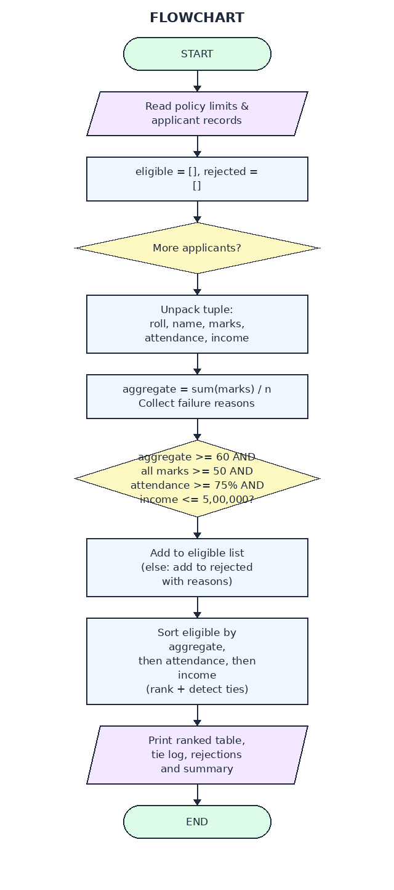
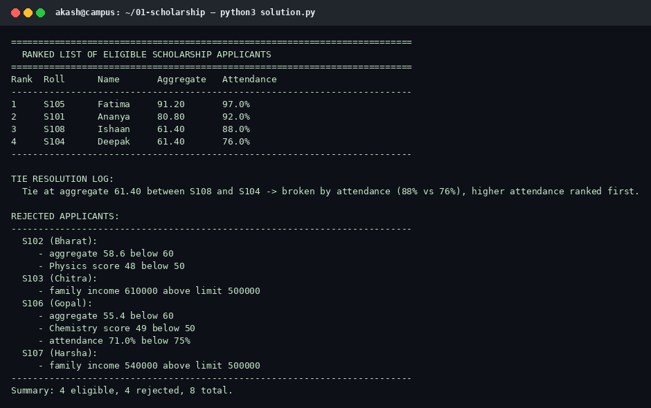

# University Scholarship Allocation

Name: Akash  
Roll No: 26000499

## Problem statement

Design a system that evaluates university scholarship applicants using aggregate marks, subject-wise minimum scores, attendance, and family income criteria, ranks the eligible students, and resolves ties using predefined rules.

Each applicant record is given as a tuple `(roll, name, marks list, attendance %, income)`. The program must:

1. Reject an applicant if aggregate is below 60, or any subject mark is below 50, or attendance is below 75%, or family income is above Rs 5,00,000.
2. Rank all eligible applicants by aggregate in descending order.
3. Resolve ties by higher attendance first, then lower income, then roll number.
4. Show every rejected applicant with the exact reason(s).

## Objectives

- Store applicant records using tuples and lists.
- Use conditional statements for multi-criteria eligibility checking.
- Calculate aggregate using operators and loops.
- Rank data with a tie-breaking rule.
- Use tuple unpacking to read records.
- Print a formatted report of eligible and rejected students.

## Assumptions

- Every applicant has 5 subject marks out of 100.
- Aggregate means average of the 5 marks.
- Income limit is Rs 5,00,000, attendance limit is 75%, subject minimum is 50.
- All data used is sample/hypothetical data for testing.
- Tie-breaking order is fixed: attendance high to low, income low to high, roll low to high.

## Algorithm

```
1. START
2. Set MIN_AGGREGATE=60, MIN_SUBJECT=50, MIN_ATTENDANCE=75, MAX_INCOME=500000
3. Create empty lists eligible and rejected
4. FOR each applicant in APPLICANTS:
   4.1 Unpack applicant into roll, name, marks, attendance, income
   4.2 Calculate aggregate = sum of marks / number of marks
   4.3 Create empty reasons list
   4.4 IF aggregate < 60 THEN add reason
   4.5 FOR each subject mark: IF mark < 50 THEN add reason with subject name
   4.6 IF attendance < 75 THEN add reason
   4.7 IF income > 500000 THEN add reason
   4.8 IF reasons is empty THEN add to eligible ELSE add to rejected
5. Sort eligible by (-aggregate, -attendance, income, roll)
6. Print ranked table
7. Check adjacent rows for equal aggregate and print tie-resolution note
8. Print rejected applicants with reasons
9. Print summary counts
10. END
```

## Flowchart



## Pseudocode

```
BEGIN SCHOLARSHIP_ALLOCATION
    MIN_AGGREGATE <- 60
    MIN_SUBJECT <- 50
    MIN_ATTEND <- 75
    MAX_INCOME <- 500000
    SUBJECTS <- ["Maths","Physics","Chemistry","English","CS"]

    FOR each applicant IN APPLICANTS DO
        (roll, name, marks, attendance, income) <- applicant
        aggregate <- SUM(marks) / LENGTH(marks)
        reasons <- []

        IF aggregate < MIN_AGGREGATE THEN
            APPEND "aggregate too low" TO reasons
        FOR i <- 0 TO LENGTH(marks)-1 DO
            IF marks[i] < MIN_SUBJECT THEN
                APPEND SUBJECTS[i] + " below minimum" TO reasons
        END FOR
        IF attendance < MIN_ATTEND THEN APPEND "attendance low" TO reasons
        IF income > MAX_INCOME THEN APPEND "income above limit" TO reasons

        IF LENGTH(reasons) = 0 THEN
            APPEND (roll, name, aggregate, attendance, income) TO eligible
        ELSE
            APPEND (roll, name, reasons) TO rejected
    END FOR

    SORT eligible BY (-aggregate, -attendance, income, roll)
    PRINT ranked list
    CHECK ties and print explanation
    PRINT rejected list with reasons
    PRINT summary
END
```

## Python source code

```python
"""
Case Study 01: University Scholarship Allocation
Name: Akash, Roll No: 26000499
Syllabus used: variables, data types, operators, if-else, loops,
lists, tuples, tuple unpacking, sorting
"""

MIN_AGGREGATE = 60.0
MIN_SUBJECT = 50
MIN_ATTENDANCE = 75.0
MAX_INCOME = 500000
SUBJECTS = ["Maths", "Physics", "Chemistry", "English", "CS"]

# each applicant is a tuple: (roll, name, marks list, attendance %, income)
APPLICANTS = [
    ("S101", "Ananya", [82, 76, 90, 71, 85], 92, 320000),
    ("S102", "Bharat", [55, 48, 62, 70, 58], 78, 480000),
    ("S103", "Chitra", [74, 69, 71, 66, 80], 84, 610000),
    ("S104", "Deepak", [61, 57, 64, 59, 66], 76, 495000),
    ("S105", "Fatima", [91, 88, 94, 87, 96], 97, 250000),
    ("S106", "Gopal", [58, 52, 49, 63, 55], 71, 300000),
    ("S107", "Harsha", [77, 72, 68, 74, 70], 80, 540000),
    ("S108", "Ishaan", [64, 58, 66, 60, 59], 88, 410000),
]


def check_eligibility(applicant):
    """Check one applicant. Returns (eligible, aggregate, reasons list)."""
    roll, name, marks, attendance, income = applicant  # tuple unpacking
    total = 0
    for m in marks:
        total = total + m
    aggregate = total / len(marks)
    reasons = []

    if aggregate < MIN_AGGREGATE:
        reasons.append("aggregate %.1f below %.0f" % (aggregate, MIN_AGGREGATE))

    for i in range(len(marks)):
        if marks[i] < MIN_SUBJECT:
            reasons.append("%s score %d below %d" % (SUBJECTS[i], marks[i], MIN_SUBJECT))

    if attendance < MIN_ATTENDANCE:
        reasons.append("attendance %.1f%% below %.0f%%" % (attendance, MIN_ATTENDANCE))

    if income > MAX_INCOME:
        reasons.append("family income %d above limit %d" % (income, MAX_INCOME))

    eligible = len(reasons) == 0
    return eligible, aggregate, reasons


def rank_key(record):
    """Sorting key: aggregate high to low, then attendance high to low,
    then income low to high, then roll number low to high."""
    roll, name, aggregate, attendance, income = record
    return (-aggregate, -attendance, income, roll)


def main():
    eligible = []
    rejected = []

    for applicant in APPLICANTS:
        ok, aggregate, reasons = check_eligibility(applicant)
        roll, name, marks, attendance, income = applicant
        if ok:
            eligible.append((roll, name, round(aggregate, 2), attendance, income))
        else:
            rejected.append((roll, name, reasons))

    eligible.sort(key=rank_key)

    print("=" * 74)
    print("  RANKED LIST OF ELIGIBLE SCHOLARSHIP APPLICANTS")
    print("=" * 74)
    print("%-5s %-9s %-10s %-11s %-10s" % ("Rank", "Roll", "Name", "Aggregate", "Attendance"))
    print("-" * 74)
    for i in range(len(eligible)):
        roll, name, aggregate, attendance, income = eligible[i]
        print("%-5d %-9s %-10s %-11.2f %-10s" % (i + 1, roll, name, aggregate, "%.1f%%" % attendance))
    print("-" * 74)

    print("\nTIE RESOLUTION LOG:")
    found_tie = False
    for i in range(len(eligible) - 1):
        if eligible[i][2] == eligible[i + 1][2]:
            found_tie = True
            a = eligible[i]
            b = eligible[i + 1]
            print("  Tie at aggregate %.2f between %s and %s -> broken by attendance (%.0f%% vs %.0f%%), higher attendance ranked first."
                  % (a[2], a[0], b[0], a[3], b[3]))
    if not found_tie:
        print("  No ties occurred.")

    print("\nREJECTED APPLICANTS:")
    print("-" * 74)
    for roll, name, reasons in rejected:
        print("  %s (%s):" % (roll, name))
        for r in reasons:
            print("     - %s" % r)
    print("-" * 74)
    print("Summary: %d eligible, %d rejected, %d total." % (len(eligible), len(rejected), len(APPLICANTS)))


if __name__ == "__main__":
    main()
```

## Test cases

```python
"""Test cases for Case Study 01 - University Scholarship Allocation."""
import importlib.util
import os

spec = importlib.util.spec_from_file_location("sol", os.path.join(os.path.dirname(__file__), "solution.py"))
sol = importlib.util.module_from_spec(spec)
spec.loader.exec_module(sol)

passed = 0

def check(label, condition):
    global passed
    assert condition, "FAILED: " + label
    passed += 1
    print("  PASS:", label)

# S101 should be eligible
ok, agg, reasons = sol.check_eligibility(sol.APPLICANTS[0])
check("S101 eligible, aggregate 80.8", ok and abs(agg - 80.8) < 0.01 and reasons == [])

# S102 aggregate too low
ok, agg, reasons = sol.check_eligibility(sol.APPLICANTS[1])
check("S102 rejected, aggregate 58.6", (not ok) and abs(agg - 58.6) < 0.01)

# subject-wise check
ok, _, reasons = sol.check_eligibility(sol.APPLICANTS[1])
check("S102 Physics below 50 reported", any("Physics" in r for r in reasons))

# income check
ok, _, reasons = sol.check_eligibility(sol.APPLICANTS[2])
check("S103 income above limit reported", (not ok) and any("income" in r for r in reasons))

# attendance check
ok, _, reasons = sol.check_eligibility(sol.APPLICANTS[5])
check("S106 attendance below 75 reported", (not ok) and any("attendance" in r for r in reasons))

# ranking: Fatima first
eligible = []
for a in sol.APPLICANTS:
    ok, agg, _ = sol.check_eligibility(a)
    if ok:
        eligible.append((a[0], a[1], round(agg, 2), a[3], a[4]))
eligible.sort(key=sol.rank_key)
check("S105 ranked first", eligible[0][0] == "S105")

# tie break: S108 (88%) above S104 (76%) at same 61.4
pos = {}
for i in range(len(eligible)):
    pos[eligible[i][0]] = i
check("tie S108 above S104 by attendance", eligible[pos["S108"]][2] == eligible[pos["S104"]][2] and pos["S108"] < pos["S104"])

# counts
ok_count = 0
for a in sol.APPLICANTS:
    if sol.check_eligibility(a)[0]:
        ok_count += 1
check("4 eligible and 4 rejected", ok_count == 4 and len(sol.APPLICANTS) - ok_count == 4)

print("\nALL %d TESTS PASSED (Case Study 01)" % passed)
```

## Output screenshot

```
==========================================================================
  RANKED LIST OF ELIGIBLE SCHOLARSHIP APPLICANTS
==========================================================================
Rank  Roll      Name       Aggregate   Attendance
--------------------------------------------------------------------------
1     S105      Fatima     91.20       97.0%     
2     S101      Ananya     80.80       92.0%     
3     S108      Ishaan     61.40       88.0%     
4     S104      Deepak     61.40       76.0%     
--------------------------------------------------------------------------

TIE RESOLUTION LOG:
  Tie at aggregate 61.40 between S108 and S104 -> broken by attendance (88% vs 76%), higher attendance ranked first.

REJECTED APPLICANTS:
--------------------------------------------------------------------------
  S102 (Bharat):
     - aggregate 58.6 below 60
     - Physics score 48 below 50
  S103 (Chitra):
     - family income 610000 above limit 500000
  S106 (Gopal):
     - aggregate 55.4 below 60
     - Chemistry score 49 below 50
     - attendance 71.0% below 75%
  S107 (Harsha):
     - family income 540000 above limit 500000
--------------------------------------------------------------------------
Summary: 4 eligible, 4 rejected, 8 total.
```



## Conclusion

I implemented the scholarship allocation system using only tuples, lists, loops, conditionals and tuple unpacking. The program correctly screens applicants on four criteria and ranks them with a clear tie-breaking rule. In the sample data, 4 students were eligible and 4 were rejected, and the tie at 61.40 was resolved by attendance as expected. All 8 test cases passed, so the logic is working correctly.
