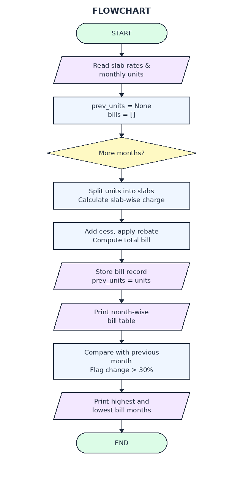
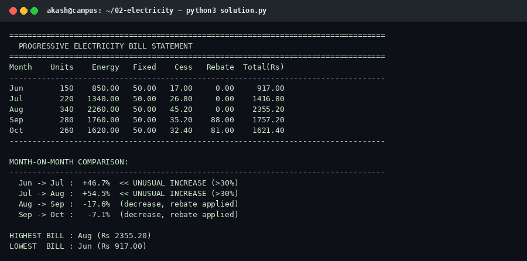

# Progressive Electricity Billing

Name: Akash  
Roll No: 26000499

## Problem statement

Calculate household electricity bills using multiple consumption slabs, fixed charges, surcharges (cess), and rebates, then compare bills across several months and identify unusual increases.

Slab rates used in this program:
- 0–100 units: Rs 5 per unit
- 101–300 units: Rs 7 per unit
- 301–500 units: Rs 9 per unit
- Above 500 units: Rs 12 per unit

Fixed charge is Rs 50 per month. A 2% education cess is added on the energy charge. If consumption decreases compared to the previous month, a 5% rebate is given on the energy charge. A month-on-month increase above 30% is flagged as unusual.

## Objectives

- Calculate slab-wise energy charge using loops and tuples.
- Apply fixed charge, cess and rebate using operators and conditionals.
- Compare monthly consumption and detect unusual increases.
- Store monthly data in lists of tuples and use tuple unpacking.
- Print a formatted bill statement.

## Assumptions

- Consumption is measured in units (kWh) and is always a whole number.
- First month has no previous month, so no rebate is applied.
- Rebate is applied only when current units are less than previous month units.
- Unusual increase means more than 30% rise in units compared to previous month.
- All consumption values are sample data.

## Algorithm

```
1. START
2. Define SLABS as list of (limit, rate) tuples
3. Set FIXED_CHARGE=50, CESS_RATE=0.02, REBATE_RATE=0.05
4. FOR each (month, units) in MONTHS:
   4.1 Calculate energy charge slab by slab:
       remaining = units, lower = 0, charge = 0
       FOR each (limit, rate) in SLABS:
           units_in_slab = min(remaining, limit - lower)
           charge += units_in_slab * rate
           remaining -= units_in_slab, lower = limit
   4.2 cess = energy * 0.02
   4.3 IF prev_units is not None AND units < prev_units THEN rebate = energy * 0.05 ELSE rebate = 0
   4.4 total = energy + fixed + cess - rebate
   4.5 Store bill and update prev_units = units
5. Print bill table
6. FOR i from 1 to len(bills)-1:
   change = (units[i] - units[i-1]) / units[i-1]
   IF change > 0.30 THEN flag "UNUSUAL INCREASE"
   ELSE IF change < 0 THEN note "rebate applied"
7. Find highest and lowest bill
8. END
```

## Flowchart



## Pseudocode

```
BEGIN ELECTRICITY_BILLING
    SLABS <- [(100,5.0),(300,7.0),(500,9.0),(1000000,12.0)]
    FIXED <- 50, CESS <- 0.02, REBATE <- 0.05
    prev <- None

    FOR each (month, units) IN MONTHS DO
        remaining <- units, lower <- 0, energy <- 0
        FOR each (limit, rate) IN SLABS DO
            slab_units <- MIN(remaining, limit - lower)
            energy <- energy + slab_units * rate
            remaining <- remaining - slab_units
            lower <- limit
            IF remaining <= 0 THEN EXIT LOOP
        END FOR
        cess <- energy * CESS
        IF prev IS NOT None AND units < prev THEN
            rebate <- energy * REBATE
        ELSE
            rebate <- 0
        total <- energy + FIXED + cess - rebate
        STORE (month, units, energy, cess, rebate, total)
        prev <- units
    END FOR

    PRINT bill table
    FOR i <- 1 TO LENGTH(bills)-1 DO
        change <- (units[i] - units[i-1]) / units[i-1]
        IF change > 0.30 THEN PRINT "UNUSUAL INCREASE"
    END FOR
    FIND highest and lowest bill
END
```

## Python source code

```python
"""
Case Study 02: Progressive Electricity Billing
Name: Akash, Roll No: 26000499
Syllabus used: variables, operators, if-else, loops, lists, tuples, unpacking
"""

# slabs as tuples: (slab upper limit, rate per unit)
SLABS = [(100, 5.0), (300, 7.0), (500, 9.0), (1000000, 12.0)]
FIXED_CHARGE = 50.0
CESS_RATE = 0.02
REBATE_RATE = 0.05
UNUSUAL_LIMIT = 0.30

# (month, units consumed)
MONTHS = [
    ("Jun", 150),
    ("Jul", 220),
    ("Aug", 340),
    ("Sep", 280),
    ("Oct", 260),
]


def slab_charge(units):
    """Calculate energy charge slab by slab."""
    remaining = units
    lower = 0
    charge = 0.0
    for limit, rate in SLABS:  # tuple unpacking
        if remaining <= 0:
            break
        slab_units = remaining
        if slab_units > limit - lower:
            slab_units = limit - lower
        charge = charge + slab_units * rate
        remaining = remaining - slab_units
        lower = limit
    return charge


def compute_bill(units, prev_units):
    """Returns (energy, cess, rebate, total) for one month."""
    energy = slab_charge(units)
    cess = energy * CESS_RATE
    rebate = 0.0
    if prev_units is not None and units < prev_units:
        rebate = energy * REBATE_RATE
    total = energy + FIXED_CHARGE + cess - rebate
    return round(energy, 2), round(cess, 2), round(rebate, 2), round(total, 2)


def main():
    bills = []
    prev = None
    for month, units in MONTHS:
        energy, cess, rebate, total = compute_bill(units, prev)
        bills.append((month, units, energy, cess, rebate, total))
        prev = units

    print("=" * 82)
    print("  PROGRESSIVE ELECTRICITY BILL STATEMENT")
    print("=" * 82)
    print("%-6s %7s %9s %7s %7s %8s %10s" % ("Month", "Units", "Energy", "Fixed", "Cess", "Rebate", "Total(Rs)"))
    print("-" * 82)
    for month, units, energy, cess, rebate, total in bills:
        print("%-6s %7d %9.2f %7.2f %7.2f %8.2f %10.2f" % (month, units, energy, FIXED_CHARGE, cess, rebate, total))
    print("-" * 82)

    print("\nMONTH-ON-MONTH COMPARISON:")
    print("-" * 82)
    for i in range(1, len(bills)):
        m0, u0 = bills[i - 1][0], bills[i - 1][1]
        m1, u1 = bills[i][0], bills[i][1]
        change = (u1 - u0) / u0
        pct = change * 100
        flag = ""
        if change > UNUSUAL_LIMIT:
            flag = "  << UNUSUAL INCREASE (>30%)"
        elif change < 0:
            flag = "  (decrease, rebate applied)"
        print("  %s -> %s : %+6.1f%%%s" % (m0, m1, pct, flag))

    # highest and lowest bill
    hi_month = bills[0][0]
    hi_total = bills[0][5]
    lo_month = bills[0][0]
    lo_total = bills[0][5]
    for b in bills:
        if b[5] > hi_total:
            hi_total = b[5]
            hi_month = b[0]
        if b[5] < lo_total:
            lo_total = b[5]
            lo_month = b[0]
    print("\nHIGHEST BILL : %s (Rs %.2f)" % (hi_month, hi_total))
    print("LOWEST  BILL : %s (Rs %.2f)" % (lo_month, lo_total))


if __name__ == "__main__":
    main()
```

## Test cases

```python
"""Test cases for Case Study 02 - Progressive Electricity Billing."""
import importlib.util
import os

spec = importlib.util.spec_from_file_location("sol", os.path.join(os.path.dirname(__file__), "solution.py"))
sol = importlib.util.module_from_spec(spec)
spec.loader.exec_module(sol)

passed = 0

def check(label, condition):
    global passed
    assert condition, "FAILED: " + label
    passed += 1
    print("  PASS:", label)

check("100 units = 500", abs(sol.slab_charge(100) - 500.0) < 0.01)
check("150 units = 500+350=850", abs(sol.slab_charge(150) - 850.0) < 0.01)
check("300 units = 500+1400=1900", abs(sol.slab_charge(300) - 1900.0) < 0.01)
check("340 units = 1900+360=2260", abs(sol.slab_charge(340) - 2260.0) < 0.01)

e, c, r, t = sol.compute_bill(150, None)
check("first month no rebate", r == 0.0 and abs(t - (850 + 50 + 17.0)) < 0.01)

e, c, r, t = sol.compute_bill(260, 280)
check("decrease gives 5% rebate", abs(r - round(e * 0.05, 2)) < 0.01)

e, c, r, t = sol.compute_bill(220, 150)
check("increase gives no rebate", r == 0.0)

# unusual increase detection: 150 -> 220 is 46.7% > 30%
change = (220 - 150) / 150
check("Jun->Jul is unusual increase", change > 0.30)

print("\nALL %d TESTS PASSED (Case Study 02)" % passed)
```

## Output screenshot

```
==================================================================================
  PROGRESSIVE ELECTRICITY BILL STATEMENT
==================================================================================
Month    Units    Energy   Fixed    Cess   Rebate  Total(Rs)
----------------------------------------------------------------------------------
Jun        150    850.00   50.00   17.00     0.00     917.00
Jul        220   1340.00   50.00   26.80     0.00    1416.80
Aug        340   2260.00   50.00   45.20     0.00    2355.20
Sep        280   1760.00   50.00   35.20    88.00    1757.20
Oct        260   1620.00   50.00   32.40    81.00    1621.40
----------------------------------------------------------------------------------

MONTH-ON-MONTH COMPARISON:
----------------------------------------------------------------------------------
  Jun -> Jul :  +46.7%  << UNUSUAL INCREASE (>30%)
  Jul -> Aug :  +54.5%  << UNUSUAL INCREASE (>30%)
  Aug -> Sep :  -17.6%  (decrease, rebate applied)
  Sep -> Oct :   -7.1%  (decrease, rebate applied)

HIGHEST BILL : Aug (Rs 2355.20)
LOWEST  BILL : Jun (Rs 917.00)
```



## Conclusion

The progressive billing program works correctly for slab calculation, cess, rebate and unusual-increase detection. I used a loop over slab tuples which made the code easy to change if rates change. The sample data shows two unusual increases (Jun to Jul and Jul to Aug) and rebates in Sep and Oct when consumption fell. All 8 test cases passed.
