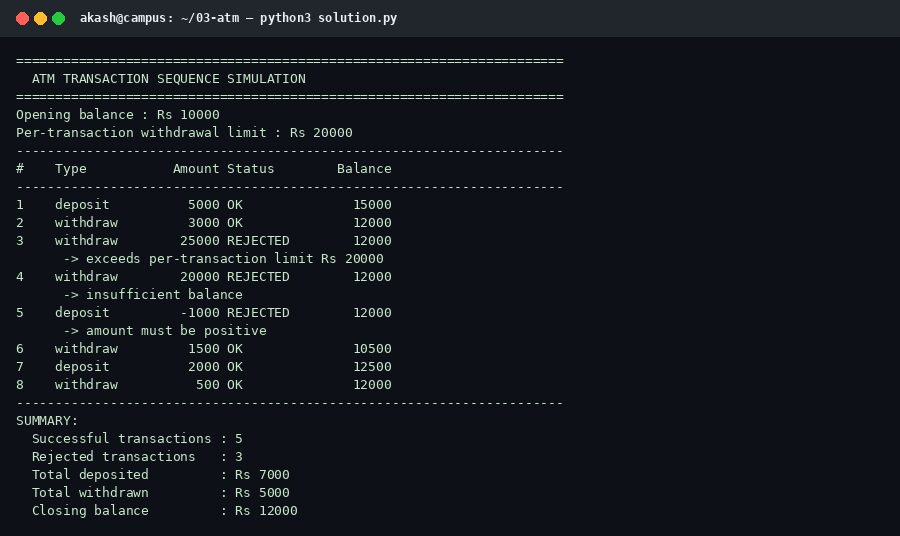

# Case Study 03 — ATM Transaction Sequence Simulation

**Name:** Akash  
**Roll No:** 26000499  
**Subject:** Python Programming — Activity-Based Learning

## 1. Problem Statement

Process a sequence of deposits and withdrawals, maintain a simulated balance, enforce withdrawal limits, reject invalid transactions, and produce a transaction summary.

Rules:
- Opening balance is Rs 10,000.
- Maximum withdrawal per transaction is Rs 20,000.
- Amount must be positive.
- Withdrawal cannot exceed current balance.
- Invalid transactions are rejected and balance stays unchanged.

## 2. Objectives

- Process transactions one by one using a loop.
- Maintain balance with operators and conditionals.
- Validate amount, limit and balance before accepting a transaction.
- Store transactions as tuples and use tuple unpacking.
- Print step-by-step log and final summary.

## 3. Assumptions

- All amounts are in rupees and are whole numbers.
- Transaction type is either "deposit" or "withdraw".
- Rejected transactions do not change the balance.
- The sequence of 8 transactions given in the code is sample data.

## 4. Algorithm

```
1. START
2. balance = 10000, MAX_LIMIT = 20000
3. FOR each transaction (type, amount) in TRANSACTIONS:
   3.1 IF amount <= 0 THEN reject "amount must be positive"
   3.2 ELSE IF type = "deposit" THEN balance += amount, status OK
   3.3 ELSE IF type = "withdraw":
       IF amount > MAX_LIMIT THEN reject "exceeds limit"
       ELSE IF amount > balance THEN reject "insufficient balance"
       ELSE balance -= amount, status OK
   3.4 Print transaction number, type, amount, status, balance
   3.5 Update counters (success, rejected, total deposit, total withdraw)
4. Print summary: counts, totals, closing balance
5. END
```

## 5. Flowchart

```
                    +---------+
                    |  START  |
                    +----┬----+
                         v
              +----------------------+
              | balance = 10000      |
              +----------+-----------+
                         v
          +-------------------------+<-----------+
          | FOR each transaction |            |
          +-----------+-------------+            |
                      v                          |
          +----------------------+               |
          | amount <= 0 ?        |--YES--> REJECT
          +-----------+----------+               |
                      NO                         |
                      v                          |
          +----------------------+               |
          | type = deposit ?     |--YES--> balance += amount
          +-----------+----------+               |
                      NO                         |
                      v                          |
          +----------------------+               |
          | amount > limit ?     |--YES--> REJECT
          +-----------+----------+               |
                      NO                         |
                      v                          |
          +----------------------+               |
          | amount > balance ?   |--YES--> REJECT
          +-----------+----------+               |
                      NO                         |
                      v                          |
          +----------------------+               |
          | balance -= amount    |---------------+
          +-----------+----------+
                      v
          +----------------------+
          | print log, update    |
          | counters             |
          +----------+-----------+
                     v
          +----------------------+
          | print summary        |
          +----------+-----------+
                     v
                  +---------+
                  |   END   |
                  +---------+
```

## 6. Pseudocode

```
BEGIN ATM_SIMULATION
    balance <- 10000
    MAX_LIMIT <- 20000
    ok_count <- 0, rejected_count <- 0
    total_deposit <- 0, total_withdraw <- 0

    FOR each (type, amount) IN TRANSACTIONS DO
        IF amount <= 0 THEN
            status <- "REJECTED"
        ELSE IF type = "deposit" THEN
            balance <- balance + amount
            status <- "OK"
            total_deposit <- total_deposit + amount
        ELSE IF amount > MAX_LIMIT THEN
            status <- "REJECTED"
        ELSE IF amount > balance THEN
            status <- "REJECTED"
        ELSE
            balance <- balance - amount
            status <- "OK"
            total_withdraw <- total_withdraw + amount
        END IF
        PRINT transaction details
    END FOR
    PRINT summary
END
```

## 7. Python Source Code

Full program: [`solution.py`](./solution.py)

```python
def process(balance, txn):
    ttype, amount = txn  # tuple unpacking
    if amount <= 0:
        return balance, "REJECTED", "amount must be positive"
    if ttype == "deposit":
        return balance + amount, "OK", "deposited Rs %d" % amount
    elif ttype == "withdraw":
        if amount > MAX_WITHDRAW_PER_TXN:
            return balance, "REJECTED", "exceeds per-transaction limit"
        if amount > balance:
            return balance, "REJECTED", "insufficient balance"
        return balance - amount, "OK", "withdrew Rs %d" % amount
    else:
        return balance, "REJECTED", "unknown transaction type"
```

Run with: `python3 solution.py`

## 8. Test Cases

Test file: [`test_cases.py`](./test_cases.py) — 7 tests, all passing.

| ID | Input | Expected | Result |
|----|-------|----------|--------|
| TC-01 | deposit 5000 on 10000 | 15000, OK | 15000 — PASS |
| TC-02 | withdraw 3000 on 15000 | 12000, OK | 12000 — PASS |
| TC-03 | withdraw 25000 on 12000 | rejected (limit) | rejected — PASS |
| TC-04 | withdraw 8000 on 5000 | rejected (balance) | rejected — PASS |
| TC-05 | deposit -1000 | rejected | rejected — PASS |
| TC-06 | deposit 0 | rejected | rejected — PASS |
| TC-07 | Full 8-transaction sequence | closing balance 12000 | 12000 — PASS |

## 9. Output



Full output: [`output.txt`](./output.txt)

```
#    Type           Amount Status        Balance
1    deposit          5000 OK              15000
2    withdraw         3000 OK              12000
3    withdraw        25000 REJECTED        12000
4    withdraw        20000 REJECTED        12000
5    deposit         -1000 REJECTED        12000
6    withdraw         1500 OK              10500
7    deposit          2000 OK              12500
8    withdraw          500 OK              12000

SUMMARY:
  Successful transactions : 5
  Rejected transactions   : 3
  Closing balance         : Rs 12000
```

## 10. Conclusion

The ATM simulation correctly handles deposits, withdrawals and all rejection cases. I tested limit violation, insufficient balance and negative amount — all were rejected without changing the balance. The closing balance of Rs 12,000 matches manual calculation. All 7 test cases passed.
