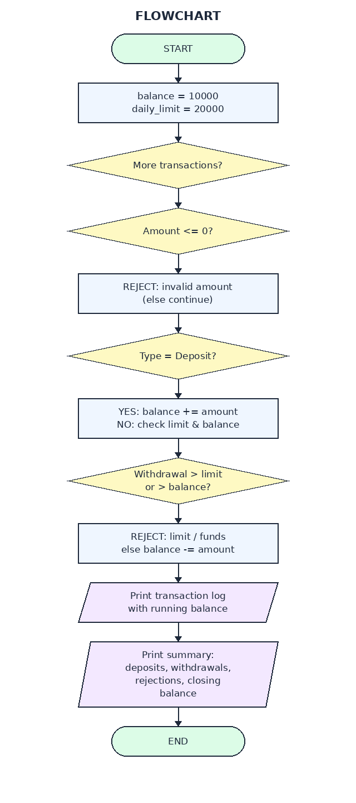

# ATM Transaction Sequence Simulation

Name: Akash  
Roll No: 26000499

## Problem statement

Process a sequence of deposits and withdrawals, maintain a simulated balance, enforce withdrawal limits, reject invalid transactions, and produce a transaction summary.

Rules:
- Opening balance is Rs 10,000.
- Maximum withdrawal per transaction is Rs 20,000.
- Amount must be positive.
- Withdrawal cannot exceed current balance.
- Invalid transactions are rejected and balance stays unchanged.

## Objectives

- Process transactions one by one using a loop.
- Maintain balance with operators and conditionals.
- Validate amount, limit and balance before accepting a transaction.
- Store transactions as tuples and use tuple unpacking.
- Print step-by-step log and final summary.

## Assumptions

- All amounts are in rupees and are whole numbers.
- Transaction type is either "deposit" or "withdraw".
- Rejected transactions do not change the balance.
- The sequence of 8 transactions given in the code is sample data.

## Algorithm

```
1. START
2. balance = 10000, MAX_LIMIT = 20000
3. FOR each transaction (type, amount) in TRANSACTIONS:
   3.1 IF amount <= 0 THEN reject "amount must be positive"
   3.2 ELSE IF type = "deposit" THEN balance += amount, status OK
   3.3 ELSE IF type = "withdraw":
       IF amount > MAX_LIMIT THEN reject "exceeds limit"
       ELSE IF amount > balance THEN reject "insufficient balance"
       ELSE balance -= amount, status OK
   3.4 Print transaction number, type, amount, status, balance
   3.5 Update counters (success, rejected, total deposit, total withdraw)
4. Print summary: counts, totals, closing balance
5. END
```

## Flowchart



## Pseudocode

```
BEGIN ATM_SIMULATION
    balance <- 10000
    MAX_LIMIT <- 20000
    ok_count <- 0, rejected_count <- 0
    total_deposit <- 0, total_withdraw <- 0

    FOR each (type, amount) IN TRANSACTIONS DO
        IF amount <= 0 THEN
            status <- "REJECTED"
        ELSE IF type = "deposit" THEN
            balance <- balance + amount
            status <- "OK"
            total_deposit <- total_deposit + amount
        ELSE IF amount > MAX_LIMIT THEN
            status <- "REJECTED"
        ELSE IF amount > balance THEN
            status <- "REJECTED"
        ELSE
            balance <- balance - amount
            status <- "OK"
            total_withdraw <- total_withdraw + amount
        END IF
        PRINT transaction details
    END FOR
    PRINT summary
END
```

## Python source code

```python
"""
Case Study 03: ATM Transaction Sequence Simulation
Name: Akash, Roll No: 26000499
Syllabus used: variables, operators, if-else, loops, lists, tuples, unpacking
"""

OPENING_BALANCE = 10000
MAX_WITHDRAW_PER_TXN = 20000

# each transaction is a tuple: (type, amount)
# type is "deposit" or "withdraw"
TRANSACTIONS = [
    ("deposit", 5000),
    ("withdraw", 3000),
    ("withdraw", 25000),
    ("withdraw", 20000),
    ("deposit", -1000),
    ("withdraw", 1500),
    ("deposit", 2000),
    ("withdraw", 500),
]


def process(balance, txn):
    """Process one transaction.
    Returns (new_balance, status, message)."""
    ttype, amount = txn  # tuple unpacking
    if amount <= 0:
        return balance, "REJECTED", "amount must be positive"
    if ttype == "deposit":
        return balance + amount, "OK", "deposited Rs %d" % amount
    elif ttype == "withdraw":
        if amount > MAX_WITHDRAW_PER_TXN:
            return balance, "REJECTED", "exceeds per-transaction limit Rs %d" % MAX_WITHDRAW_PER_TXN
        if amount > balance:
            return balance, "REJECTED", "insufficient balance"
        return balance - amount, "OK", "withdrew Rs %d" % amount
    else:
        return balance, "REJECTED", "unknown transaction type"


def main():
    balance = OPENING_BALANCE
    print("=" * 70)
    print("  ATM TRANSACTION SEQUENCE SIMULATION")
    print("=" * 70)
    print("Opening balance : Rs %d" % balance)
    print("Per-transaction withdrawal limit : Rs %d" % MAX_WITHDRAW_PER_TXN)
    print("-" * 70)
    print("%-4s %-10s %10s %-10s %10s" % ("#", "Type", "Amount", "Status", "Balance"))
    print("-" * 70)

    ok_count = 0
    rejected_count = 0
    total_deposit = 0
    total_withdraw = 0

    for i in range(len(TRANSACTIONS)):
        txn = TRANSACTIONS[i]
        ttype, amount = txn
        balance, status, msg = process(balance, txn)
        if status == "OK":
            ok_count = ok_count + 1
            if ttype == "deposit":
                total_deposit = total_deposit + amount
            else:
                total_withdraw = total_withdraw + amount
        else:
            rejected_count = rejected_count + 1
        print("%-4d %-10s %10d %-10s %10d" % (i + 1, ttype, amount, status, balance))
        if status == "REJECTED":
            print("      -> %s" % msg)

    print("-" * 70)
    print("SUMMARY:")
    print("  Successful transactions : %d" % ok_count)
    print("  Rejected transactions   : %d" % rejected_count)
    print("  Total deposited         : Rs %d" % total_deposit)
    print("  Total withdrawn         : Rs %d" % total_withdraw)
    print("  Closing balance         : Rs %d" % balance)


if __name__ == "__main__":
    main()
```

## Test cases

```python
"""Test cases for Case Study 03 - ATM Transaction Sequence Simulation."""
import importlib.util
import os

spec = importlib.util.spec_from_file_location("sol", os.path.join(os.path.dirname(__file__), "solution.py"))
sol = importlib.util.module_from_spec(spec)
spec.loader.exec_module(sol)

passed = 0

def check(label, condition):
    global passed
    assert condition, "FAILED: " + label
    passed += 1
    print("  PASS:", label)

b, s, m = sol.process(10000, ("deposit", 5000))
check("deposit works", b == 15000 and s == "OK")

b, s, m = sol.process(15000, ("withdraw", 3000))
check("withdraw works", b == 12000 and s == "OK")

b, s, m = sol.process(12000, ("withdraw", 25000))
check("over-limit withdraw rejected", b == 12000 and s == "REJECTED")

b, s, m = sol.process(5000, ("withdraw", 8000))
check("insufficient balance rejected", b == 5000 and s == "REJECTED")

b, s, m = sol.process(5000, ("deposit", -1000))
check("negative amount rejected", b == 5000 and s == "REJECTED")

b, s, m = sol.process(5000, ("deposit", 0))
check("zero amount rejected", b == 5000 and s == "REJECTED")

# full sequence closing balance
bal = sol.OPENING_BALANCE
for txn in sol.TRANSACTIONS:
    bal, _, _ = sol.process(bal, txn)
check("closing balance is 12000", bal == 12000)

print("\nALL %d TESTS PASSED (Case Study 03)" % passed)
```

## Output screenshot

```
======================================================================
  ATM TRANSACTION SEQUENCE SIMULATION
======================================================================
Opening balance : Rs 10000
Per-transaction withdrawal limit : Rs 20000
----------------------------------------------------------------------
#    Type           Amount Status        Balance
----------------------------------------------------------------------
1    deposit          5000 OK              15000
2    withdraw         3000 OK              12000
3    withdraw        25000 REJECTED        12000
      -> exceeds per-transaction limit Rs 20000
4    withdraw        20000 REJECTED        12000
      -> insufficient balance
5    deposit         -1000 REJECTED        12000
      -> amount must be positive
6    withdraw         1500 OK              10500
7    deposit          2000 OK              12500
8    withdraw          500 OK              12000
----------------------------------------------------------------------
SUMMARY:
  Successful transactions : 5
  Rejected transactions   : 3
  Total deposited         : Rs 7000
  Total withdrawn         : Rs 5000
  Closing balance         : Rs 12000
```


## Conclusion

The ATM simulation correctly handles deposits, withdrawals and all rejection cases. I tested limit violation, insufficient balance and negative amount — all were rejected without changing the balance. The closing balance of Rs 12,000 matches manual calculation. All 7 test cases passed.
