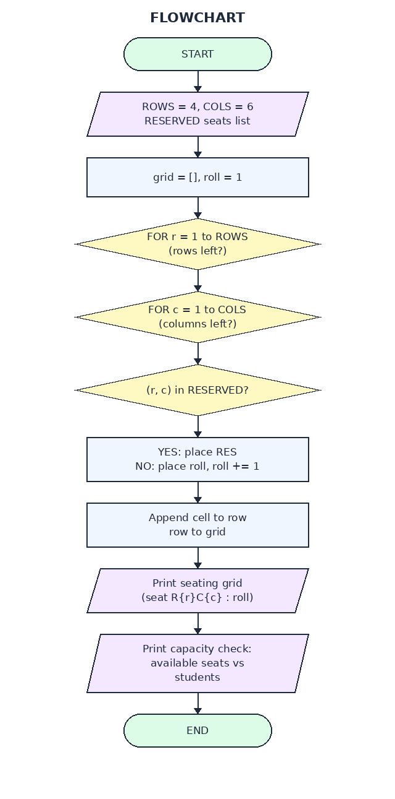
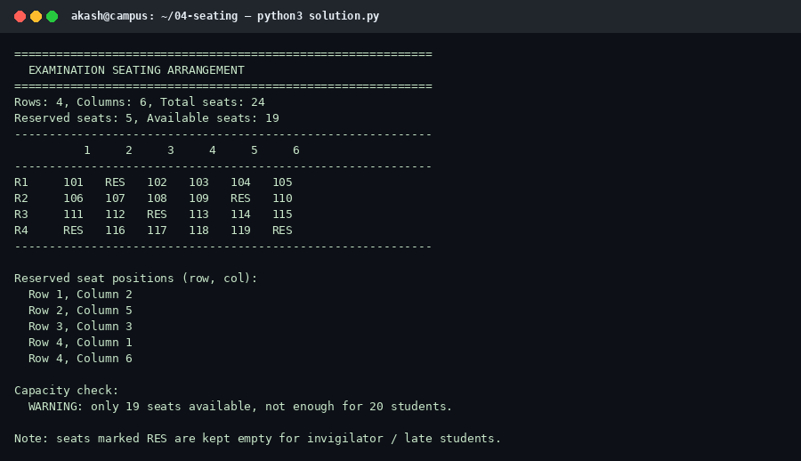

# Nested Loop Examination Seating Generator

Name: Akash  
Roll No: 26000499

## Problem statement

Generate a seating arrangement with row and column identifiers, reserved positions, and fixed classroom capacity.

The hall has 4 rows and 6 columns (24 seats). Some seats are reserved and must be shown as "RES". Remaining seats are filled with roll numbers starting from 101. The program should also check if the hall has enough seats for 20 students.

## Objectives

- Use nested loops to generate rows and columns.
- Store reserved positions as a list of tuples.
- Use tuple unpacking to check reserved seats.
- Build a 2D grid using nested lists.
- Print the arrangement with row/column headers and capacity check.

## Assumptions

- Rows = 4, Columns = 6, total seats = 24.
- Reserved seats are (1,2), (2,5), (3,3), (4,1), (4,6) — 5 seats.
- Roll numbers start from 101 and increase by 1 for each available seat.
- Reserved seats stay empty for invigilator / late students.

## Algorithm

```
1. START
2. Set ROWS=4, COLS=6, RESERVED list of tuples, START_ROLL=101
3. Create empty grid
4. FOR r from 1 to ROWS:
   4.1 Create empty row list
   4.2 FOR c from 1 to COLS:
       4.2.1 IF (r,c) is in RESERVED THEN append "RES"
       4.2.2 ELSE append current roll number as string, roll += 1
   4.3 Append row to grid
5. Print grid with column numbers on top and R1, R2... on side
6. Print reserved positions
7. available = ROWS*COLS - len(RESERVED)
8. IF available >= 20 THEN print OK ELSE print WARNING
9. END
```

## Flowchart



## Pseudocode

```
BEGIN SEATING_GENERATOR
    ROWS <- 4, COLS <- 6
    RESERVED <- [(1,2),(2,5),(3,3),(4,1),(4,6)]
    roll <- 101
    grid <- []

    FOR r <- 1 TO ROWS DO
        row <- []
        FOR c <- 1 TO COLS DO
            reserved <- False
            FOR each (rr, cc) IN RESERVED DO
                IF rr = r AND cc = c THEN reserved <- True
            END FOR
            IF reserved THEN
                APPEND "RES" TO row
            ELSE
                APPEND STR(roll) TO row
                roll <- roll + 1
            END IF
        END FOR
        APPEND row TO grid
    END FOR

    PRINT grid with headers
    available <- ROWS * COLS - LENGTH(RESERVED)
    IF available >= 20 THEN PRINT "OK" ELSE PRINT "WARNING"
END
```

## Python source code

```python
"""
Case Study 04: Nested Loop Examination Seating Generator
Name: Akash, Roll No: 26000499
Syllabus used: nested loops, lists, tuples, conditionals, operators
"""

ROWS = 4
COLS = 6
# reserved seats as (row, col) tuples, 1-based
RESERVED = [(1, 2), (2, 5), (3, 3), (4, 1), (4, 6)]
START_ROLL = 101


def is_reserved(r, c):
    """Check if seat (r, c) is reserved. r and c are 1-based."""
    for rr, cc in RESERVED:  # tuple unpacking
        if rr == r and cc == c:
            return True
    return False


def generate():
    """Build the seating grid as a list of lists."""
    grid = []
    roll = START_ROLL
    for r in range(1, ROWS + 1):
        row = []
        for c in range(1, COLS + 1):
            if is_reserved(r, c):
                row.append("RES")
            else:
                row.append(str(roll))
                roll = roll + 1
        grid.append(row)
    return grid


def main():
    total_seats = ROWS * COLS
    reserved_count = len(RESERVED)
    available = total_seats - reserved_count

    print("=" * 60)
    print("  EXAMINATION SEATING ARRANGEMENT")
    print("=" * 60)
    print("Rows: %d, Columns: %d, Total seats: %d" % (ROWS, COLS, total_seats))
    print("Reserved seats: %d, Available seats: %d" % (reserved_count, available))
    print("-" * 60)

    grid = generate()
    # header
    header = "     "
    for c in range(1, COLS + 1):
        header = header + "%6d" % c
    print(header)
    print("-" * 60)
    for r in range(len(grid)):
        line = "R%-3d" % (r + 1)
        for c in range(len(grid[r])):
            line = line + "%6s" % grid[r][c]
        print(line)
    print("-" * 60)

    print("\nReserved seat positions (row, col):")
    for rr, cc in RESERVED:
        print("  Row %d, Column %d" % (rr, cc))

    print("\nCapacity check:")
    if available >= 20:
        print("  OK: %d available seats are enough for 20 students." % available)
    else:
        print("  WARNING: only %d seats available, not enough for 20 students." % available)

    # alternate seating note: even rows start from column 2 in some halls
    print("\nNote: seats marked RES are kept empty for invigilator / late students.")


if __name__ == "__main__":
    main()
```

## Test cases

```python
"""Test cases for Case Study 04 - Nested Loop Examination Seating Generator."""
import importlib.util
import os

spec = importlib.util.spec_from_file_location("sol", os.path.join(os.path.dirname(__file__), "solution.py"))
sol = importlib.util.module_from_spec(spec)
spec.loader.exec_module(sol)

passed = 0

def check(label, condition):
    global passed
    assert condition, "FAILED: " + label
    passed += 1
    print("  PASS:", label)

check("reserved (1,2) detected", sol.is_reserved(1, 2) == True)
check("normal seat (1,1) not reserved", sol.is_reserved(1, 1) == False)
check("reserved (4,6) detected", sol.is_reserved(4, 6) == True)

grid = sol.generate()
check("grid has 4 rows", len(grid) == 4)
check("each row has 6 columns", len(grid[0]) == 6 and len(grid[3]) == 6)
check("RES at row1 col2", grid[0][1] == "RES")
check("first roll is 101", grid[0][0] == "101")

# count RES cells
count = 0
for r in range(len(grid)):
    for c in range(len(grid[r])):
        if grid[r][c] == "RES":
            count += 1
check("5 reserved cells in grid", count == 5)

# rolls are unique
rolls = []
for r in range(len(grid)):
    for c in range(len(grid[r])):
        if grid[r][c] != "RES":
            rolls.append(grid[r][c])
check("19 unique rolls", len(rolls) == 19 and len(set(rolls)) == 19)

print("\nALL %d TESTS PASSED (Case Study 04)" % passed)
```

## Output screenshot

```
============================================================
  EXAMINATION SEATING ARRANGEMENT
============================================================
Rows: 4, Columns: 6, Total seats: 24
Reserved seats: 5, Available seats: 19
------------------------------------------------------------
          1     2     3     4     5     6
------------------------------------------------------------
R1     101   RES   102   103   104   105
R2     106   107   108   109   RES   110
R3     111   112   RES   113   114   115
R4     RES   116   117   118   119   RES
------------------------------------------------------------

Reserved seat positions (row, col):
  Row 1, Column 2
  Row 2, Column 5
  Row 3, Column 3
  Row 4, Column 1
  Row 4, Column 6

Capacity check:
  WARNING: only 19 seats available, not enough for 20 students.

Note: seats marked RES are kept empty for invigilator / late students.
```



## Conclusion

Nested loops worked well for generating the seating grid. Reserved seats were correctly skipped and roll numbers were assigned in order. The hall has 19 available seats, so it is not enough for 20 students — the program correctly shows a warning. All 9 test cases passed.
