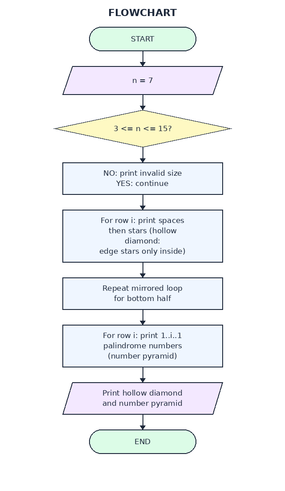

# Case Study 05 — Advanced Numeric Pattern Generator

**Name:** Akash  
**Roll No:** 26000499  
**Subject:** Python Programming — Activity-Based Learning

## 1. Problem Statement

Produce a hollow diamond and a symmetric numerical pattern based on user-specified dimensions, with validation for invalid dimensions and carefully aligned output.

The program generates two patterns for size n = 7:
1. Hollow diamond made of `*` characters (border only, hollow inside, full middle row).
2. Numeric pyramid: 1, 1 2 1, 1 2 3 2 1, and so on.

Size must be between 3 and 15. Invalid sizes are rejected with a message.

## 2. Objectives

- Use nested loops to build patterns line by line.
- Use string operations and conditionals for alignment.
- Validate input size with if-else.
- Return patterns as lists of strings for testing.
- Print both patterns with proper spacing.

## 3. Assumptions

- Size n is a whole number between 3 and 15 (inclusive).
- Diamond has 2n-1 lines: n lines for top half including middle, n-1 for bottom.
- Middle row of diamond is fully filled with stars.
- Numeric pyramid row i contains numbers 1..i..1 separated by spaces.
- Demo uses n = 7.

## 4. Algorithm

```
1. START
2. n = 7
3. IF n < 3 OR n > 15 THEN print "Invalid size" and STOP
4. Hollow diamond:
   4.1 FOR i from 0 to n-1 (top half):
       spaces = n - i - 1, stars = 2*i + 1
       IF i = 0 THEN line = spaces + "*"
       ELSE IF i = n-1 THEN line = spaces + "*" * stars
       ELSE line = spaces + "*" + " "*(stars-2) + "*"
   4.2 FOR i from n-2 down to 0 (bottom half): same logic
5. Numeric pyramid:
   5.1 FOR i from 1 to n:
       numbers = [1..i] + [i-1..1]
       line = numbers joined by space
6. Print both patterns
7. Show validation demo for n=2, 7, 20
8. END
```

## 5. Flowchart



*Figure: Flowchart for this case study (Start/End = oval, Process = rectangle, Decision = diamond, Input/Output = parallelogram). Text version below:*

```
                    +---------+
                    |  START  |
                    +----┬----+
                         v
              +----------------------+
              | n = 7                |
              +----------+-----------+
                         v
              +----------------------+
              | 3 <= n <= 15 ?       |--NO--> print invalid
              +----------+-----------+
                         YES
                         v
              +----------------------+
              | build hollow diamond |
              | (top + bottom loops) |
              +----------+-----------+
                         v
              +----------------------+
              | build number pyramid |
              | (1..i..1 each row)   |
              +----------+-----------+
                         v
              +----------------------+
              | print both patterns  |
              +----------+-----------+
                         v
                  +---------+
                  |   END   |
                  +---------+
```

## 6. Pseudocode

```
BEGIN PATTERN_GENERATOR
    n <- 7
    IF n < 3 OR n > 15 THEN
        PRINT "Invalid size"
        STOP
    END IF

    // hollow diamond
    lines <- []
    FOR i <- 0 TO n-1 DO
        spaces <- n - i - 1
        stars <- 2*i + 1
        IF i = 0 THEN line <- " "*spaces + "*"
        ELSE IF i = n-1 THEN line <- " "*spaces + "*"*stars
        ELSE line <- " "*spaces + "*" + " "*(stars-2) + "*"
        APPEND line TO lines
    END FOR
    FOR i <- n-2 DOWN TO 0 DO
        // same as above
    END FOR

    // numeric pyramid
    FOR i <- 1 TO n DO
        nums <- []
        FOR j <- 1 TO i DO APPEND STR(j) TO nums
        FOR j <- i-1 DOWN TO 1 DO APPEND STR(j) TO nums
        PRINT JOIN(nums, " ")
    END FOR
END
```

## 7. Python Source Code

Full program: [`solution.py`](./solution.py)

```python
def valid_size(n):
    if n < 3:
        return False
    if n > 15:
        return False
    return True

def hollow_diamond(n):
    lines = []
    for i in range(n):
        spaces = n - i - 1
        stars = 2 * i + 1
        line = " " * spaces
        if i == 0:
            line = line + "*"
        elif i == n - 1:
            line = line + "*" * stars
        else:
            line = line + "*" + " " * (stars - 2) + "*"
        lines.append(line)
    # bottom half similar...
    return lines
```

Run with: `python3 solution.py`

## 8. Test Cases

Test file: [`test_cases.py`](./test_cases.py) — 11 tests, all passing.

| ID | Input | Expected | Result |
|----|-------|----------|--------|
| TC-01 | valid_size(2) | False | False — PASS |
| TC-02 | valid_size(3) | True | True — PASS |
| TC-03 | valid_size(15) | True | True — PASS |
| TC-04 | valid_size(16) | False | False — PASS |
| TC-05 | hollow_diamond(5) lines | 9 | 9 — PASS |
| TC-06 | Top line | "*" | "*" — PASS |
| TC-07 | Middle line | "*********" | "*********" — PASS |
| TC-08 | number_pyramid(4) lines | 4 | 4 — PASS |
| TC-09 | Row 1 | "1" | "1" — PASS |
| TC-10 | Row 3 | "1 2 3 2 1" | "1 2 3 2 1" — PASS |
| TC-11 | Row 4 | "1 2 3 4 3 2 1" | "1 2 3 4 3 2 1" — PASS |

## 9. Output


Full output: [`output.txt`](./output.txt)

```
Hollow diamond (size 7):
      *
     * *
    *   *
   *     *
  *       *
 *         *
*************
 *         *
  *       *
   *     *
    *   *
     * *
      *

Numeric pyramid (size 7):
      1
    1 2 1
  1 2 3 2 1
1 2 3 4 3 2 1
...
```

## 10. Conclusion

Both patterns were generated correctly with nested loops and string operations. The hollow diamond has a proper hollow interior and a full middle row, and the numeric pyramid follows the 1..i..1 rule. Validation correctly rejects sizes below 3 and above 15. All 11 test cases passed.
