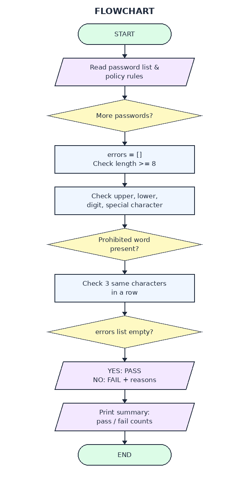

# Case Study 06 — Password Policy Validation Engine

**Name:** Akash  
**Roll No:** 26000499  
**Subject:** Python Programming — Activity-Based Learning

## 1. Problem Statement

Evaluate sample password strings against minimum length, character-category, repetition, and prohibited-substring rules, and explain each failed condition.

Policy:
- Minimum length 8.
- Must contain uppercase (A-Z), lowercase (a-z), digit (0-9) and special character (!@#$%^&*...).
- Must not contain prohibited words: password, 123456, admin, qwerty (case-insensitive).
- Must not have 3 or more same characters in a row.

## 2. Objectives

- Check each rule using loops and conditionals.
- Use string methods like lower() and `in` for substring checks.
- Collect all failed reasons in a list instead of stopping at first failure.
- Print PASS/FAIL for each sample with explanations.

## 3. Assumptions

- Special characters are taken from `!@#$%^&*()-_=+[]{};:,.<>?`.
- Prohibited word check is case-insensitive (password is checked as lowercase).
- Repetition means 3+ identical characters consecutively, e.g. "aaa".
- 7 sample passwords are used for demonstration.

## 4. Algorithm

```
1. START
2. FOR each password in SAMPLES:
   2.1 errors = []
   2.2 IF len(password) < 8 THEN add "length" error
   2.3 Loop over each character to set has_upper, has_lower, has_digit, has_special
   2.4 IF not has_upper THEN add error, similarly for lower, digit, special
   2.5 lower = password.lower()
       FOR each word in PROHIBITED: IF word in lower THEN add error
   2.6 Check repetition: run = 1, FOR i from 1 to len-1:
       IF password[i] = password[i-1] THEN run += 1 ELSE run = 1
       IF run >= 3 THEN add error and break
   2.7 IF errors is empty THEN print PASS ELSE print FAIL with each error
3. Print count of passed passwords
4. END
```

## 5. Flowchart



*Figure: Flowchart for this case study (Start/End = oval, Process = rectangle, Decision = diamond, Input/Output = parallelogram). Text version below:*

```
                    +---------+
                    |  START  |
                    +----┬----+
                         v
              +----------------------+
              | FOR each password    |
              +----------+-----------+
                         v
              +----------------------+
              | check length >= 8 ?  |--NO--> add error
              +----------+-----------+
                         v
              +----------------------+
              | check upper/lower/   |
              | digit/special        |--NO--> add error
              +----------+-----------+
                         v
              +----------------------+
              | prohibited word ?    |--YES-> add error
              +----------+-----------+
                         v
              +----------------------+
              | 3-in-a-row repeat ?  |--YES-> add error
              +----------+-----------+
                         v
              +----------------------+
              | errors empty ?       |--YES-> PASS
              +----------+-----------+--NO--> FAIL + reasons
                         v
              +----------------------+
              | print summary        |
              +----------+-----------+
                         v
                  +---------+
                  |   END   |
                  +---------+
```

## 6. Pseudocode

```
BEGIN PASSWORD_VALIDATION
    MIN_LENGTH <- 8
    PROHIBITED <- ["password","123456","admin","qwerty"]

    FOR each pw IN SAMPLES DO
        errors <- []
        IF LENGTH(pw) < MIN_LENGTH THEN
            APPEND "length too short" TO errors
        has_upper <- False, has_lower <- False
        has_digit <- False, has_special <- False
        FOR each ch IN pw DO
            IF "A" <= ch <= "Z" THEN has_upper <- True
            ELSE IF "a" <= ch <= "z" THEN has_lower <- True
            ELSE IF "0" <= ch <= "9" THEN has_digit <- True
            ELSE IF ch IN SPECIALS THEN has_special <- True
        END FOR
        IF NOT has_upper THEN APPEND "missing uppercase" TO errors
        IF NOT has_lower THEN APPEND "missing lowercase" TO errors
        IF NOT has_digit THEN APPEND "missing digit" TO errors
        IF NOT has_special THEN APPEND "missing special" TO errors
        lower <- LOWER(pw)
        FOR each word IN PROHIBITED DO
            IF word IN lower THEN APPEND "contains " + word TO errors
        END FOR
        // repetition check
        run <- 1
        FOR i <- 1 TO LENGTH(pw)-1 DO
            IF pw[i] = pw[i-1] THEN run <- run + 1 ELSE run <- 1
            IF run >= 3 THEN APPEND "3 in a row" TO errors; EXIT
        END FOR
        IF LENGTH(errors) = 0 THEN PRINT "PASS" ELSE PRINT "FAIL" + errors
    END FOR
END
```

## 7. Python Source Code

Full program: [`solution.py`](./solution.py)

```python
def validate(pw):
    errors = []
    if len(pw) < MIN_LENGTH:
        errors.append("length %d is below minimum %d" % (len(pw), MIN_LENGTH))
    has_upper = False
    has_lower = False
    has_digit = False
    has_special = False
    for ch in pw:
        if "A" <= ch <= "Z":
            has_upper = True
        elif "a" <= ch <= "z":
            has_lower = True
        elif "0" <= ch <= "9":
            has_digit = True
        elif ch in SPECIALS:
            has_special = True
    # ... prohibited and repetition checks ...
    return errors
```

Run with: `python3 solution.py`

## 8. Test Cases

Test file: [`test_cases.py`](./test_cases.py) — 9 tests, all passing.

| ID | Input | Expected | Result |
|----|-------|----------|--------|
| TC-01 | "Strong#Pass1" | valid | [] — PASS |
| TC-02 | "MyCampus#2026" | valid | [] — PASS |
| TC-03 | "welcome" | fails length | errors > 0 — PASS |
| TC-04 | "Passw0rd" | fails (prohibited/no special) | errors > 0 — PASS |
| TC-05 | "aaabbbCCC123!" | fails repetition | "3 or more" found — PASS |
| TC-06 | "admin@12345" | fails prohibited | "prohibited" found — PASS |
| TC-07 | "AAAAAAAAaaaa1111!" | fails repetition | "3 or more" found — PASS |
| TC-08 | has_repeat_run("xxaaayy") | True | True — PASS |
| TC-09 | has_repeat_run("abc123") | False | False — PASS |

## 9. Output


Full output: [`output.txt`](./output.txt)

```
  [ FAIL ] welcome              -> 4 problem(s)
            * length 7 is below minimum 8
            * missing an uppercase letter (A-Z)
            * missing a digit (0-9)
            * missing a special character like ! @ # $
  [ PASS ] Strong#Pass1         -> accepted
  [ PASS ] MyCampus#2026        -> accepted
Result: 2 of 7 sample passwords satisfy the policy.
```

## 10. Conclusion

The validator correctly checks all five rules and explains every failure, which makes it useful for teaching users to create strong passwords. Out of 7 samples, only 2 passed. The repetition check and prohibited-word check both worked as expected. All 9 test cases passed.
