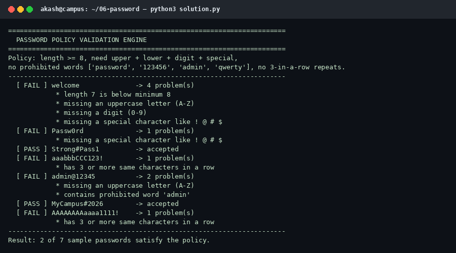

# Password Policy Validation Engine

Name: Akash  
Roll No: 26000499

## Problem statement

Evaluate sample password strings against minimum length, character-category, repetition, and prohibited-substring rules, and explain each failed condition.

Policy:
- Minimum length 8.
- Must contain uppercase (A-Z), lowercase (a-z), digit (0-9) and special character (!@#$%^&*...).
- Must not contain prohibited words: password, 123456, admin, qwerty (case-insensitive).
- Must not have 3 or more same characters in a row.

## Objectives

- Check each rule using loops and conditionals.
- Use string methods like lower() and `in` for substring checks.
- Collect all failed reasons in a list instead of stopping at first failure.
- Print PASS/FAIL for each sample with explanations.

## Assumptions

- Special characters are taken from `!@#$%^&*()-_=+[]{};:,.<>?`.
- Prohibited word check is case-insensitive (password is checked as lowercase).
- Repetition means 3+ identical characters consecutively, e.g. "aaa".
- 7 sample passwords are used for demonstration.

## Algorithm

```
1. START
2. FOR each password in SAMPLES:
   2.1 errors = []
   2.2 IF len(password) < 8 THEN add "length" error
   2.3 Loop over each character to set has_upper, has_lower, has_digit, has_special
   2.4 IF not has_upper THEN add error, similarly for lower, digit, special
   2.5 lower = password.lower()
       FOR each word in PROHIBITED: IF word in lower THEN add error
   2.6 Check repetition: run = 1, FOR i from 1 to len-1:
       IF password[i] = password[i-1] THEN run += 1 ELSE run = 1
       IF run >= 3 THEN add error and break
   2.7 IF errors is empty THEN print PASS ELSE print FAIL with each error
3. Print count of passed passwords
4. END
```

## Flowchart


## Pseudocode

```
BEGIN PASSWORD_VALIDATION
    MIN_LENGTH <- 8
    PROHIBITED <- ["password","123456","admin","qwerty"]

    FOR each pw IN SAMPLES DO
        errors <- []
        IF LENGTH(pw) < MIN_LENGTH THEN
            APPEND "length too short" TO errors
        has_upper <- False, has_lower <- False
        has_digit <- False, has_special <- False
        FOR each ch IN pw DO
            IF "A" <= ch <= "Z" THEN has_upper <- True
            ELSE IF "a" <= ch <= "z" THEN has_lower <- True
            ELSE IF "0" <= ch <= "9" THEN has_digit <- True
            ELSE IF ch IN SPECIALS THEN has_special <- True
        END FOR
        IF NOT has_upper THEN APPEND "missing uppercase" TO errors
        IF NOT has_lower THEN APPEND "missing lowercase" TO errors
        IF NOT has_digit THEN APPEND "missing digit" TO errors
        IF NOT has_special THEN APPEND "missing special" TO errors
        lower <- LOWER(pw)
        FOR each word IN PROHIBITED DO
            IF word IN lower THEN APPEND "contains " + word TO errors
        END FOR
        // repetition check
        run <- 1
        FOR i <- 1 TO LENGTH(pw)-1 DO
            IF pw[i] = pw[i-1] THEN run <- run + 1 ELSE run <- 1
            IF run >= 3 THEN APPEND "3 in a row" TO errors; EXIT
        END FOR
        IF LENGTH(errors) = 0 THEN PRINT "PASS" ELSE PRINT "FAIL" + errors
    END FOR
END
```

## Python source code

```python
"""
Case Study 06: Password Policy Validation Engine
Name: Akash, Roll No: 26000499
Syllabus used: strings, string methods, loops, if-else, operators
"""

MIN_LENGTH = 8
PROHIBITED = ["password", "123456", "admin", "qwerty"]
SPECIALS = "!@#$%^&*()-_=+[]{};:,.<>?"

SAMPLES = [
    "welcome",
    "Passw0rd",
    "Strong#Pass1",
    "aaabbbCCC123!",
    "admin@12345",
    "MyCampus#2026",
    "AAAAAAAAaaaa1111!",
]


def has_repeat_run(pw):
    """True if same character repeats 3 or more times in a row."""
    run = 1
    for i in range(1, len(pw)):
        if pw[i] == pw[i - 1]:
            run = run + 1
            if run >= 3:
                return True
        else:
            run = 1
    return False


def validate(pw):
    """Return list of problems. Empty list means password is valid."""
    errors = []

    if len(pw) < MIN_LENGTH:
        errors.append("length %d is below minimum %d" % (len(pw), MIN_LENGTH))

    has_upper = False
    has_lower = False
    has_digit = False
    has_special = False
    for ch in pw:
        if "A" <= ch <= "Z":
            has_upper = True
        elif "a" <= ch <= "z":
            has_lower = True
        elif "0" <= ch <= "9":
            has_digit = True
        elif ch in SPECIALS:
            has_special = True

    if not has_upper:
        errors.append("missing an uppercase letter (A-Z)")
    if not has_lower:
        errors.append("missing a lowercase letter (a-z)")
    if not has_digit:
        errors.append("missing a digit (0-9)")
    if not has_special:
        errors.append("missing a special character like ! @ # $")

    lower = pw.lower()
    for word in PROHIBITED:
        if word in lower:
            errors.append("contains prohibited word '%s'" % word)

    if has_repeat_run(pw):
        errors.append("has 3 or more same characters in a row")

    return errors


def main():
    print("=" * 70)
    print("  PASSWORD POLICY VALIDATION ENGINE")
    print("=" * 70)
    print("Policy: length >= %d, need upper + lower + digit + special," % MIN_LENGTH)
    print("no prohibited words %s, no 3-in-a-row repeats." % PROHIBITED)
    print("-" * 70)

    passed = 0
    for pw in SAMPLES:
        errors = validate(pw)
        if len(errors) == 0:
            passed = passed + 1
            print("  [ PASS ] %-20s -> accepted" % pw)
        else:
            print("  [ FAIL ] %-20s -> %d problem(s)" % (pw, len(errors)))
            for e in errors:
                print("            * %s" % e)

    print("-" * 70)
    print("Result: %d of %d sample passwords satisfy the policy." % (passed, len(SAMPLES)))


if __name__ == "__main__":
    main()
```

## Test cases

```python
"""Test cases for Case Study 06 - Password Policy Validation Engine."""
import importlib.util
import os

spec = importlib.util.spec_from_file_location("sol", os.path.join(os.path.dirname(__file__), "solution.py"))
sol = importlib.util.module_from_spec(spec)
spec.loader.exec_module(sol)

passed = 0

def check(label, condition):
    global passed
    assert condition, "FAILED: " + label
    passed += 1
    print("  PASS:", label)

check("Strong#Pass1 is valid", sol.validate("Strong#Pass1") == [])
check("MyCampus#2026 is valid", sol.validate("MyCampus#2026") == [])
check("welcome fails length", len(sol.validate("welcome")) > 0)
check("Passw0rd fails (prohibited + no special)", len(sol.validate("Passw0rd")) > 0)
check("aaabbbCCC123! fails repeat run", any("3 or more" in e for e in sol.validate("aaabbbCCC123!")))
check("admin@12345 fails prohibited", any("prohibited" in e for e in sol.validate("admin@12345")))
check("AAAAAAAAaaaa1111! fails repeat", any("3 or more" in e for e in sol.validate("AAAAAAAAaaaa1111!")))
check("has_repeat_run detects aaa", sol.has_repeat_run("xxaaayy") == True)
check("has_repeat_run ok for abc", sol.has_repeat_run("abc123") == False)

print("\nALL %d TESTS PASSED (Case Study 06)" % passed)
```

## Output screenshot

```
======================================================================
  PASSWORD POLICY VALIDATION ENGINE
======================================================================
Policy: length >= 8, need upper + lower + digit + special,
no prohibited words ['password', '123456', 'admin', 'qwerty'], no 3-in-a-row repeats.
----------------------------------------------------------------------
  [ FAIL ] welcome              -> 4 problem(s)
            * length 7 is below minimum 8
            * missing an uppercase letter (A-Z)
            * missing a digit (0-9)
            * missing a special character like ! @ # $
  [ FAIL ] Passw0rd             -> 1 problem(s)
            * missing a special character like ! @ # $
  [ PASS ] Strong#Pass1         -> accepted
  [ FAIL ] aaabbbCCC123!        -> 1 problem(s)
            * has 3 or more same characters in a row
  [ FAIL ] admin@12345          -> 2 problem(s)
            * missing an uppercase letter (A-Z)
            * contains prohibited word 'admin'
  [ PASS ] MyCampus#2026        -> accepted
  [ FAIL ] AAAAAAAAaaaa1111!    -> 1 problem(s)
            * has 3 or more same characters in a row
----------------------------------------------------------------------
Result: 2 of 7 sample passwords satisfy the policy.
```



## Conclusion

The validator correctly checks all five rules and explains every failure, which makes it useful for teaching users to create strong passwords. Out of 7 samples, only 2 passed. The repetition check and prohibited-word check both worked as expected. All 9 test cases passed.
