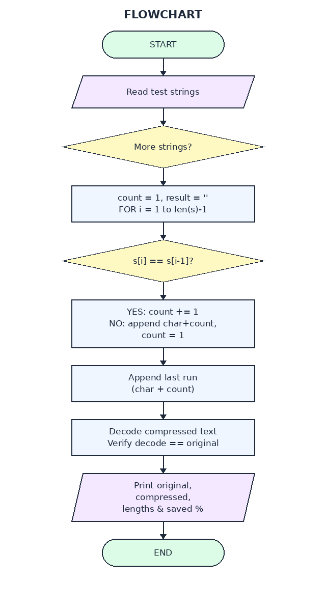
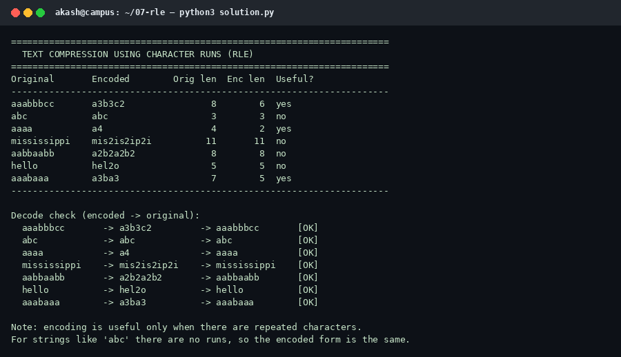

# Text Compression Using Character Runs

Name: Akash  
Roll No: 26000499

## Problem statement

Encode a string by grouping consecutive repeated characters (run-length encoding) and compare original and encoded lengths, including cases where encoding is not beneficial.

Example: `aaabbbcc` becomes `a3b3c2`. Single characters with count 1 stay as-is (e.g. `abc` stays `abc`). The program also decodes back to verify correctness.

## Objectives

- Traverse a string with a loop and count consecutive repeats.
- Build encoded string using string concatenation.
- Compare original length vs encoded length.
- Implement decoding to verify round-trip correctness.
- Show cases where compression helps and where it does not.

## Assumptions

- Input strings contain only lowercase letters (no digits), so digits in encoded form are unambiguous.
- Count is written as a decimal number after the character (e.g. a3 means three a's).
- If count is 1, only the character is written, not "a1".
- 7 sample strings are used.

## Algorithm

```
1. START
2. FOR each string s in SAMPLES:
   2.1 result = "", count = 1
   2.2 FOR i from 1 to len(s)-1:
       IF s[i] = s[i-1] THEN count += 1
       ELSE:
           IF count = 1 THEN result += s[i-1]
           ELSE result += s[i-1] + str(count)
           count = 1
   2.3 Handle last run similarly
   2.4 encoded = result
   2.5 Print original, encoded, lengths, useful? (len(encoded) < len(s))
3. Decode check: FOR each s, decode(compress(s)) should equal s
4. END
```

Decode algorithm:
```
1. result = "", i = 0
2. WHILE i < len(s):
   ch = s[i], i += 1
   num = ""
   WHILE i < len(s) AND s[i] is digit: num += s[i], i += 1
   IF num = "" THEN result += ch
   ELSE result += ch repeated int(num) times
3. Return result
```

## Flowchart



## Pseudocode

```
BEGIN RLE_COMPRESSION
    FOR each s IN SAMPLES DO
        result <- ""
        count <- 1
        FOR i <- 1 TO LENGTH(s)-1 DO
            IF s[i] = s[i-1] THEN
                count <- count + 1
            ELSE
                IF count = 1 THEN result <- result + s[i-1]
                ELSE result <- result + s[i-1] + STR(count)
                count <- 1
            END IF
        END FOR
        IF count = 1 THEN result <- result + s[LENGTH(s)-1]
        ELSE result <- result + s[LENGTH(s)-1] + STR(count)
        PRINT s, result, LENGTH(s), LENGTH(result)
    END FOR
    // decode check
    FOR each s IN SAMPLES DO
        IF DECODE(ENCODE(s)) = s THEN PRINT "OK" ELSE PRINT "MISMATCH"
    END FOR
END
```

## Python source code

```python
"""
Case Study 07: Text Compression Using Character Runs
Name: Akash, Roll No: 26000499
Syllabus used: strings, loops, conditionals, operators, lists
"""

SAMPLES = [
    "aaabbbcc",
    "abc",
    "aaaa",
    "mississippi",
    "aabbaabb",
    "hello",
    "aaabaaa",
]


def compress(s):
    """Run-length encode: aaabbb -> a3b3. Single chars stay as-is if count 1."""
    if len(s) == 0:
        return ""
    result = ""
    count = 1
    for i in range(1, len(s)):
        if s[i] == s[i - 1]:
            count = count + 1
        else:
            if count == 1:
                result = result + s[i - 1]
            else:
                result = result + s[i - 1] + str(count)
            count = 1
    # last run
    if count == 1:
        result = result + s[len(s) - 1]
    else:
        result = result + s[len(s) - 1] + str(count)
    return result


def decompress(s):
    """Decode a run-length string back to original."""
    result = ""
    i = 0
    while i < len(s):
        ch = s[i]
        i = i + 1
        num = ""
        while i < len(s) and "0" <= s[i] <= "9":
            num = num + s[i]
            i = i + 1
        if num == "":
            result = result + ch
        else:
            n = int(num)
            for k in range(n):
                result = result + ch
    return result


def main():
    print("=" * 70)
    print("  TEXT COMPRESSION USING CHARACTER RUNS (RLE)")
    print("=" * 70)
    print("%-14s %-14s %8s %8s  %s" % ("Original", "Encoded", "Orig len", "Enc len", "Useful?"))
    print("-" * 70)
    for s in SAMPLES:
        enc = compress(s)
        useful = "yes" if len(enc) < len(s) else "no"
        print("%-14s %-14s %8d %8d  %s" % (s, enc, len(s), len(enc), useful))

    print("-" * 70)
    print("\nDecode check (encoded -> original):")
    for s in SAMPLES:
        enc = compress(s)
        dec = decompress(enc)
        ok = "OK" if dec == s else "MISMATCH"
        print("  %-14s -> %-14s -> %-14s [%s]" % (s, enc, dec, ok))

    print("\nNote: encoding is useful only when there are repeated characters.")
    print("For strings like 'abc' there are no runs, so the encoded form is the same.")


if __name__ == "__main__":
    main()
```

## Test cases

```python
"""Test cases for Case Study 07 - Text Compression Using Character Runs."""
import importlib.util
import os

spec = importlib.util.spec_from_file_location("sol", os.path.join(os.path.dirname(__file__), "solution.py"))
sol = importlib.util.module_from_spec(spec)
spec.loader.exec_module(sol)

passed = 0

def check(label, condition):
    global passed
    assert condition, "FAILED: " + label
    passed += 1
    print("  PASS:", label)

check("aaabbbcc -> a3b3c2", sol.compress("aaabbbcc") == "a3b3c2")
check("abc stays abc", sol.compress("abc") == "abc")
check("aaaa -> a4", sol.compress("aaaa") == "a4")
check("empty stays empty", sol.compress("") == "")
check("single char", sol.compress("x") == "x")
check("mississippi roundtrip", sol.decompress(sol.compress("mississippi")) == "mississippi")
check("aaabaaa roundtrip", sol.decompress(sol.compress("aaabaaa")) == "aaabaaa")
check("aabbaabb -> a2b2a2b2", sol.compress("aabbaabb") == "a2b2a2b2")
check("hello -> hel2o", sol.compress("hello") == "hel2o")

print("\nALL %d TESTS PASSED (Case Study 07)" % passed)
```

## Output screenshot

```
======================================================================
  TEXT COMPRESSION USING CHARACTER RUNS (RLE)
======================================================================
Original       Encoded        Orig len  Enc len  Useful?
----------------------------------------------------------------------
aaabbbcc       a3b3c2                8        6  yes
abc            abc                   3        3  no
aaaa           a4                    4        2  yes
mississippi    mis2is2ip2i          11       11  no
aabbaabb       a2b2a2b2              8        8  no
hello          hel2o                 5        5  no
aaabaaa        a3ba3                 7        5  yes
----------------------------------------------------------------------

Decode check (encoded -> original):
  aaabbbcc       -> a3b3c2         -> aaabbbcc       [OK]
  abc            -> abc            -> abc            [OK]
  aaaa           -> a4             -> aaaa           [OK]
  mississippi    -> mis2is2ip2i    -> mississippi    [OK]
  aabbaabb       -> a2b2a2b2       -> aabbaabb       [OK]
  hello          -> hel2o          -> hello          [OK]
  aaabaaa        -> a3ba3          -> aaabaaa        [OK]

Note: encoding is useful only when there are repeated characters.
For strings like 'abc' there are no runs, so the encoded form is the same.
```



## Conclusion

Run-length encoding works well when there are many repeats (e.g. `aaaa` becomes `a4`), but it does not help for strings without repeats like `abc`. The decode check confirmed that every encoded string converts back to the original. All 9 test cases passed.
