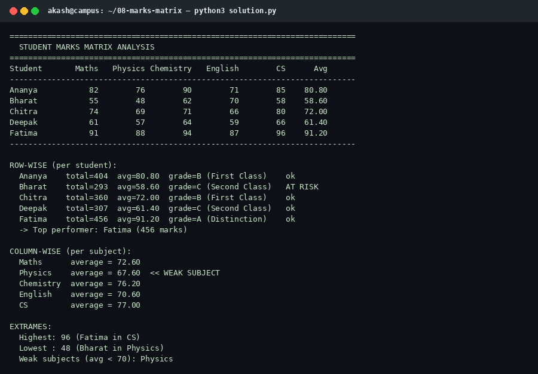

# Case Study 08 — Student Marks Matrix Analysis

**Name:** Akash  
**Roll No:** 26000499  
**Subject:** Python Programming — Activity-Based Learning

## 1. Problem Statement

Analyse a matrix of student marks across subjects, calculate row-wise and column-wise statistics, identify top performers, and detect subjects with low average performance.

Matrix has 5 students (rows) and 5 subjects (columns): Maths, Physics, Chemistry, English, CS. The program prints the matrix, per-student totals/averages/grades, per-subject averages, and overall highest/lowest marks.

## 2. Objectives

- Store marks as a nested list (list of lists).
- Calculate row totals and averages using loops.
- Calculate column averages using nested loops.
- Find maximum and minimum values with their positions.
- Classify grades and flag weak subjects and at-risk students.

## 3. Assumptions

- Marks are out of 100 and stored as integers.
- Grade rules: A >= 85, B >= 70, C >= 55, D < 55.
- Weak subject means column average below 70.
- At-risk student means row average below 60.
- Sample matrix of 5 students is used.

## 4. Algorithm

```
1. START
2. Print matrix with header and per-row average
3. Row-wise:
   FOR each row r:
       total = sum of row, avg = total / 5
       grade = grade_of(avg)
       status = "AT RISK" if avg < 60 else "ok"
       track best total and best student
4. Column-wise:
   FOR each column c:
       total = sum of MARKS[r][c] for all r
       avg = total / 5
       IF avg < 70 THEN flag "WEAK SUBJECT"
5. Extremes:
   Loop over all cells, track high and low with (row, col) positions
6. Print top performer, extremes, weak subjects
7. END
```

## 5. Flowchart

```
                    +---------+
                    |  START  |
                    +----┬----+
                         v
              +----------------------+
              | print matrix         |
              +----------+-----------+
                         v
              +----------------------+
              | FOR each student row |
              | total, avg, grade    |
              +----------+-----------+
                         v
              +----------------------+
              | FOR each subject col |
              | average, weak check  |
              +----------+-----------+
                         v
              +----------------------+
              | find high / low with |
              | positions            |
              +----------+-----------+
                         v
              +----------------------+
              | print summary        |
              +----------+-----------+
                         v
                  +---------+
                  |   END   |
                  +---------+
```

## 6. Pseudocode

```
BEGIN MARKS_MATRIX
    SUBJECTS <- ["Maths","Physics","Chemistry","English","CS"]
    STUDENTS <- ["Ananya","Bharat","Chitra","Deepak","Fatima"]
    MARKS <- [[82,76,90,71,85], ...]  // 5x5 nested list

    PRINT matrix with averages

    best_total <- -1
    FOR r <- 0 TO 4 DO
        total <- 0
        FOR c <- 0 TO 4 DO total <- total + MARKS[r][c]
        avg <- total / 5
        grade <- GRADE_OF(avg)
        IF total > best_total THEN best_total <- total, best <- r
    END FOR

    FOR c <- 0 TO 4 DO
        total <- 0
        FOR r <- 0 TO 4 DO total <- total + MARKS[r][c]
        avg <- total / 5
        IF avg < 70 THEN PRINT "WEAK SUBJECT"
    END FOR

    high <- -1, low <- 101
    FOR r <- 0 TO 4 DO
        FOR c <- 0 TO 4 DO
            IF MARKS[r][c] > high THEN high <- MARKS[r][c], hi <- (r,c)
            IF MARKS[r][c] < low THEN low <- MARKS[r][c], lo <- (r,c)
    END FOR
    PRINT extremes
END
```

## 7. Python Source Code

Full program: [`solution.py`](./solution.py)

```python
def grade_of(avg):
    if avg >= 85:
        return "A (Distinction)"
    if avg >= 70:
        return "B (First Class)"
    if avg >= 55:
        return "C (Second Class)"
    return "D (Third Class)"

# column average example:
for c in range(len(SUBJECTS)):
    total = 0
    for r in range(len(STUDENTS)):
        total = total + MARKS[r][c]
    avg = total / len(STUDENTS)
```

Run with: `python3 solution.py`

## 8. Test Cases

Test file: [`test_cases.py`](./test_cases.py) — 8 tests, all passing.

| ID | Input | Expected | Result |
|----|-------|----------|--------|
| TC-01 | grade_of(90) | "A (Distinction)" | A — PASS |
| TC-02 | grade_of(75) | "B (First Class)" | B — PASS |
| TC-03 | grade_of(60) | "C (Second Class)" | C — PASS |
| TC-04 | grade_of(40) | "D (Third Class)" | D — PASS |
| TC-05 | Fatima row total | 456 | 456 — PASS |
| TC-06 | Maths column average | 72.6 | 72.6 — PASS |
| TC-07 | Highest mark in matrix | 96 | 96 — PASS |
| TC-08 | Lowest mark in matrix | 48 | 48 — PASS |

## 9. Output



Full output: [`output.txt`](./output.txt)

```
Student       Maths   Physics Chemistry   English        CS      Avg
Ananya           82        76        90        71        85    80.80
Bharat           55        48        62        70        58    58.60
Fatima           91        88        94        87        96    91.20

ROW-WISE (per student):
  Fatima    total=456  avg=91.20  grade=A (Distinction)    ok
  -> Top performer: Fatima (456 marks)

COLUMN-WISE (per subject):
  Physics    average = 67.60  << WEAK SUBJECT
```

## 10. Conclusion

Nested lists made it easy to store and analyse the marks matrix. Fatima is the top performer with 456 marks, and Physics is the weak subject with an average of 67.60. Bharat is flagged as at-risk with an average of 58.60. All 8 test cases passed.
