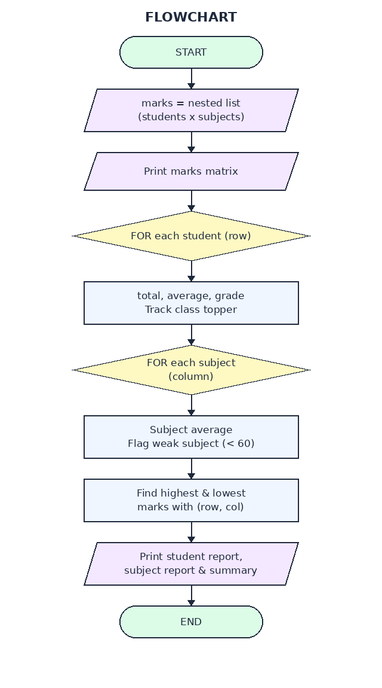

# Student Marks Matrix Analysis

Name: Akash  
Roll No: 26000499

## Problem statement

Analyse a matrix of student marks across subjects, calculate row-wise and column-wise statistics, identify top performers, and detect subjects with low average performance.

Matrix has 5 students (rows) and 5 subjects (columns): Maths, Physics, Chemistry, English, CS. The program prints the matrix, per-student totals/averages/grades, per-subject averages, and overall highest/lowest marks.

## Objectives

- Store marks as a nested list (list of lists).
- Calculate row totals and averages using loops.
- Calculate column averages using nested loops.
- Find maximum and minimum values with their positions.
- Classify grades and flag weak subjects and at-risk students.

## Assumptions

- Marks are out of 100 and stored as integers.
- Grade rules: A >= 85, B >= 70, C >= 55, D < 55.
- Weak subject means column average below 70.
- At-risk student means row average below 60.
- Sample matrix of 5 students is used.

## Algorithm

```
1. START
2. Print matrix with header and per-row average
3. Row-wise:
   FOR each row r:
       total = sum of row, avg = total / 5
       grade = grade_of(avg)
       status = "AT RISK" if avg < 60 else "ok"
       track best total and best student
4. Column-wise:
   FOR each column c:
       total = sum of MARKS[r][c] for all r
       avg = total / 5
       IF avg < 70 THEN flag "WEAK SUBJECT"
5. Extremes:
   Loop over all cells, track high and low with (row, col) positions
6. Print top performer, extremes, weak subjects
7. END
```

## Flowchart



## Pseudocode

```
BEGIN MARKS_MATRIX
    SUBJECTS <- ["Maths","Physics","Chemistry","English","CS"]
    STUDENTS <- ["Ananya","Bharat","Chitra","Deepak","Fatima"]
    MARKS <- [[82,76,90,71,85], ...]  // 5x5 nested list

    PRINT matrix with averages

    best_total <- -1
    FOR r <- 0 TO 4 DO
        total <- 0
        FOR c <- 0 TO 4 DO total <- total + MARKS[r][c]
        avg <- total / 5
        grade <- GRADE_OF(avg)
        IF total > best_total THEN best_total <- total, best <- r
    END FOR

    FOR c <- 0 TO 4 DO
        total <- 0
        FOR r <- 0 TO 4 DO total <- total + MARKS[r][c]
        avg <- total / 5
        IF avg < 70 THEN PRINT "WEAK SUBJECT"
    END FOR

    high <- -1, low <- 101
    FOR r <- 0 TO 4 DO
        FOR c <- 0 TO 4 DO
            IF MARKS[r][c] > high THEN high <- MARKS[r][c], hi <- (r,c)
            IF MARKS[r][c] < low THEN low <- MARKS[r][c], lo <- (r,c)
    END FOR
    PRINT extremes
END
```

## Python source code

```python
"""
Case Study 08: Student Marks Matrix Analysis
Name: Akash, Roll No: 26000499
Syllabus used: nested lists, loops, conditionals, operators
"""

SUBJECTS = ["Maths", "Physics", "Chemistry", "English", "CS"]
STUDENTS = ["Ananya", "Bharat", "Chitra", "Deepak", "Fatima"]

# rows = students, columns = subjects
MARKS = [
    [82, 76, 90, 71, 85],
    [55, 48, 62, 70, 58],
    [74, 69, 71, 66, 80],
    [61, 57, 64, 59, 66],
    [91, 88, 94, 87, 96],
]

WEAK_AVG = 70.0
RISK_AVG = 60.0


def grade_of(avg):
    if avg >= 85:
        return "A (Distinction)"
    if avg >= 70:
        return "B (First Class)"
    if avg >= 55:
        return "C (Second Class)"
    return "D (Third Class)"


def main():
    print("=" * 74)
    print("  STUDENT MARKS MATRIX ANALYSIS")
    print("=" * 74)
    header = "%-9s" % "Student"
    for s in SUBJECTS:
        header = header + "%10s" % s
    header = header + "%9s" % "Avg"
    print(header)
    print("-" * 74)
    for r in range(len(STUDENTS)):
        row = MARKS[r]
        total = 0
        for m in row:
            total = total + m
        avg = total / len(row)
        line = "%-9s" % STUDENTS[r]
        for m in row:
            line = line + "%10d" % m
        line = line + "%9.2f" % avg
        print(line)
    print("-" * 74)

    print("\nROW-WISE (per student):")
    best_total = -1
    best_index = -1
    for r in range(len(STUDENTS)):
        total = 0
        for m in MARKS[r]:
            total = total + m
        avg = total / len(MARKS[r])
        status = "AT RISK" if avg < RISK_AVG else "ok"
        print("  %-9s total=%3d  avg=%5.2f  grade=%-18s %s" % (STUDENTS[r], total, avg, grade_of(avg), status))
        if total > best_total:
            best_total = total
            best_index = r
    print("  -> Top performer: %s (%d marks)" % (STUDENTS[best_index], best_total))

    print("\nCOLUMN-WISE (per subject):")
    weak = []
    for c in range(len(SUBJECTS)):
        total = 0
        for r in range(len(STUDENTS)):
            total = total + MARKS[r][c]
        avg = total / len(STUDENTS)
        flag = ""
        if avg < WEAK_AVG:
            flag = "  << WEAK SUBJECT"
            weak.append(SUBJECTS[c])
        print("  %-10s average = %5.2f%s" % (SUBJECTS[c], avg, flag))

    high = -1
    low = 101
    hi_r = 0
    hi_c = 0
    lo_r = 0
    lo_c = 0
    for r in range(len(STUDENTS)):
        for c in range(len(SUBJECTS)):
            if MARKS[r][c] > high:
                high = MARKS[r][c]
                hi_r = r
                hi_c = c
            if MARKS[r][c] < low:
                low = MARKS[r][c]
                lo_r = r
                lo_c = c
    print("\nEXTREMES:")
    print("  Highest: %d (%s in %s)" % (high, STUDENTS[hi_r], SUBJECTS[hi_c]))
    print("  Lowest : %d (%s in %s)" % (low, STUDENTS[lo_r], SUBJECTS[lo_c]))
    if len(weak) == 0:
        print("  Weak subjects (avg < %.0f): none" % WEAK_AVG)
    else:
        print("  Weak subjects (avg < %.0f): %s" % (WEAK_AVG, ", ".join(weak)))


if __name__ == "__main__":
    main()
```

## Test cases

```python
"""Test cases for Case Study 08 - Student Marks Matrix Analysis."""
import importlib.util
import os

spec = importlib.util.spec_from_file_location("sol", os.path.join(os.path.dirname(__file__), "solution.py"))
sol = importlib.util.module_from_spec(spec)
spec.loader.exec_module(sol)

passed = 0

def check(label, condition):
    global passed
    assert condition, "FAILED: " + label
    passed += 1
    print("  PASS:", label)

check("grade A for 90", sol.grade_of(90) == "A (Distinction)")
check("grade B for 75", sol.grade_of(75) == "B (First Class)")
check("grade C for 60", sol.grade_of(60) == "C (Second Class)")
check("grade D for 40", sol.grade_of(40) == "D (Third Class)")

# Fatima total = 91+88+94+87+96 = 456
total = 0
for m in sol.MARKS[4]:
    total = total + m
check("Fatima total 456", total == 456)

# Maths column average = (82+55+74+61+91)/5 = 72.6
total = 0
for r in range(5):
    total = total + sol.MARKS[r][0]
avg = total / 5
check("Maths average 72.6", abs(avg - 72.6) < 0.01)

# highest mark is 96
high = -1
for r in range(5):
    for c in range(5):
        if sol.MARKS[r][c] > high:
            high = sol.MARKS[r][c]
check("highest mark 96", high == 96)

# lowest mark is 48
low = 101
for r in range(5):
    for c in range(5):
        if sol.MARKS[r][c] < low:
            low = sol.MARKS[r][c]
check("lowest mark 48", low == 48)

print("\nALL %d TESTS PASSED (Case Study 08)" % passed)
```

## Output screenshot

```
==========================================================================
  STUDENT MARKS MATRIX ANALYSIS
==========================================================================
Student       Maths   Physics Chemistry   English        CS      Avg
--------------------------------------------------------------------------
Ananya           82        76        90        71        85    80.80
Bharat           55        48        62        70        58    58.60
Chitra           74        69        71        66        80    72.00
Deepak           61        57        64        59        66    61.40
Fatima           91        88        94        87        96    91.20
--------------------------------------------------------------------------

ROW-WISE (per student):
  Ananya    total=404  avg=80.80  grade=B (First Class)    ok
  Bharat    total=293  avg=58.60  grade=C (Second Class)   AT RISK
  Chitra    total=360  avg=72.00  grade=B (First Class)    ok
  Deepak    total=307  avg=61.40  grade=C (Second Class)   ok
  Fatima    total=456  avg=91.20  grade=A (Distinction)    ok
  -> Top performer: Fatima (456 marks)

COLUMN-WISE (per subject):
  Maths      average = 72.60
  Physics    average = 67.60  << WEAK SUBJECT
  Chemistry  average = 76.20
  English    average = 70.60
  CS         average = 77.00

EXTREMES:
  Highest: 96 (Fatima in CS)
  Lowest : 48 (Bharat in Physics)
  Weak subjects (avg < 70): Physics
```


## Conclusion

Nested lists made it easy to store and analyse the marks matrix. Fatima is the top performer with 456 marks, and Physics is the weak subject with an average of 67.60. Bharat is flagged as at-risk with an average of 58.60. All 8 test cases passed.
