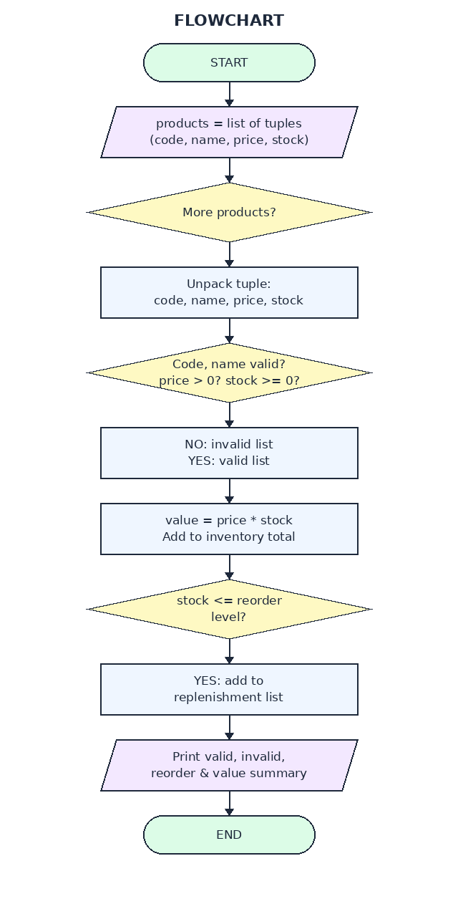
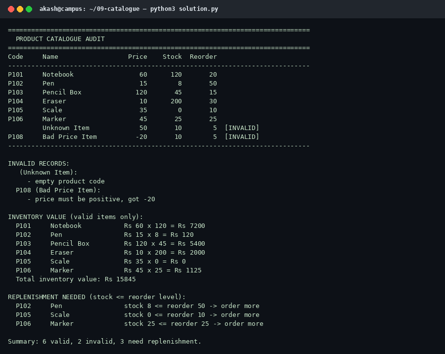

# Case Study 09 — Tuple-Based Product Catalogue Audit

**Name:** Akash  
**Roll No:** 26000499  
**Subject:** Python Programming — Activity-Based Learning

## 1. Problem Statement

Store product identifiers, prices, and stock quantities in tuples; detect invalid records, calculate inventory values, and identify items requiring replenishment.

Each product is a tuple `(code, name, price, stock, reorder level)`. Invalid means empty code/name, price <= 0, stock < 0, or reorder < 0. Inventory value is price × stock. Replenishment is needed when stock <= reorder level.

## 2. Objectives

- Store catalogue as a list of tuples.
- Use tuple unpacking to read each record.
- Validate records with conditionals and collect problems.
- Calculate inventory value with operators and loops.
- Identify replenishment items.

## 3. Assumptions

- Price and stock are integers (price in rupees).
- Reorder level is the minimum stock before ordering more.
- Invalid records are excluded from inventory value calculation.
- 8 sample products are used, including 2 invalid ones for testing.

## 4. Algorithm

```
1. START
2. FOR each product tuple in PRODUCTS:
   2.1 Unpack into code, name, price, stock, reorder
   2.2 problems = []
   2.3 IF code = "" THEN add "empty code"
   2.4 IF name = "" THEN add "empty name"
   2.5 IF price <= 0 THEN add "price must be positive"
   2.6 IF stock < 0 THEN add "stock cannot be negative"
   2.7 IF problems empty THEN valid list ELSE invalid list
3. Print valid table and invalid records with reasons
4. total_value = 0
   FOR each valid product: value = price * stock, total_value += value
5. FOR each valid product: IF stock <= reorder THEN print "order more"
6. Print summary counts
7. END
```

## 5. Flowchart



*Figure: Flowchart for this case study (Start/End = oval, Process = rectangle, Decision = diamond, Input/Output = parallelogram). Text version below:*

```
                    +---------+
                    |  START  |
                    +----┬----+
                         v
              +----------------------+
              | FOR each product     |
              +----------+-----------+
                         v
              +----------------------+
              | unpack tuple         |
              | check code/name/     |
              | price/stock valid?   |--NO--> invalid list
              +----------+-----------+
                         YES
                         v
              +----------------------+
              | add to valid list    |
              +----------+-----------+
                         v
              +----------------------+
              | calculate inventory  |
              | value (price*stock)  |
              +----------+-----------+
                         v
              +----------------------+
              | stock <= reorder ?   |--YES-> replenishment list
              +----------+-----------+
                         v
              +----------------------+
              | print summary        |
              +----------+-----------+
                         v
                  +---------+
                  |   END   |
                  +---------+
```

## 6. Pseudocode

```
BEGIN CATALOGUE_AUDIT
    PRODUCTS <- [(code, name, price, stock, reorder), ...]
    valid <- [], invalid <- []

    FOR each p IN PRODUCTS DO
        (code, name, price, stock, reorder) <- p
        problems <- []
        IF code = "" THEN APPEND "empty code" TO problems
        IF name = "" THEN APPEND "empty name" TO problems
        IF price <= 0 THEN APPEND "price must be positive" TO problems
        IF stock < 0 THEN APPEND "stock negative" TO problems
        IF LENGTH(problems) = 0 THEN APPEND p TO valid
        ELSE APPEND (p, problems) TO invalid
    END FOR

    total <- 0
    FOR each (code, name, price, stock, reorder) IN valid DO
        total <- total + price * stock
    END FOR

    FOR each valid product DO
        IF stock <= reorder THEN PRINT "needs replenishment"
    END FOR
    PRINT summary
END
```

## 7. Python Source Code

Full program: [`solution.py`](./solution.py)

```python
def check_product(p):
    code, name, price, stock, reorder = p  # tuple unpacking
    problems = []
    if code == "":
        problems.append("empty product code")
    if name == "":
        problems.append("empty product name")
    if price <= 0:
        problems.append("price must be positive, got %d" % price)
    if stock < 0:
        problems.append("stock cannot be negative, got %d" % stock)
    if reorder < 0:
        problems.append("reorder level cannot be negative")
    return problems
```

Run with: `python3 solution.py`

## 8. Test Cases

Test file: [`test_cases.py`](./test_cases.py) — 9 tests, all passing.

| ID | Input | Expected | Result |
|----|-------|----------|--------|
| TC-01 | P101 Notebook | valid | [] — PASS |
| TC-02 | P102 Pen (low stock) | valid | [] — PASS |
| TC-03 | Empty code record | invalid | errors > 0 — PASS |
| TC-04 | Negative price record | invalid | "price" found — PASS |
| TC-05 | Negative stock | invalid | errors > 0 — PASS |
| TC-06 | Empty name | invalid | errors > 0 — PASS |
| TC-07 | Valid product count | 6 | 6 — PASS |
| TC-08 | Total inventory value | 15845 | 15845 — PASS |
| TC-09 | Replenishment count | 3 | 3 — PASS |

## 9. Output



Full output: [`output.txt`](./output.txt)

```
Code     Name                  Price    Stock  Reorder
P101     Notebook                 60      120       20
P102     Pen                      15        8       50
...
INVALID RECORDS:
   (Unknown Item):
     - empty product code
  P108 (Bad Price Item):
     - price must be positive, got -20

Total inventory value: Rs 15845
```

## 10. Conclusion

Tuples worked well for storing fixed-format product records, and unpacking made the code readable. Out of 8 products, 6 were valid and 2 were invalid. Total inventory value of valid items is Rs 15,845, and 3 items need replenishment. All 9 test cases passed.
