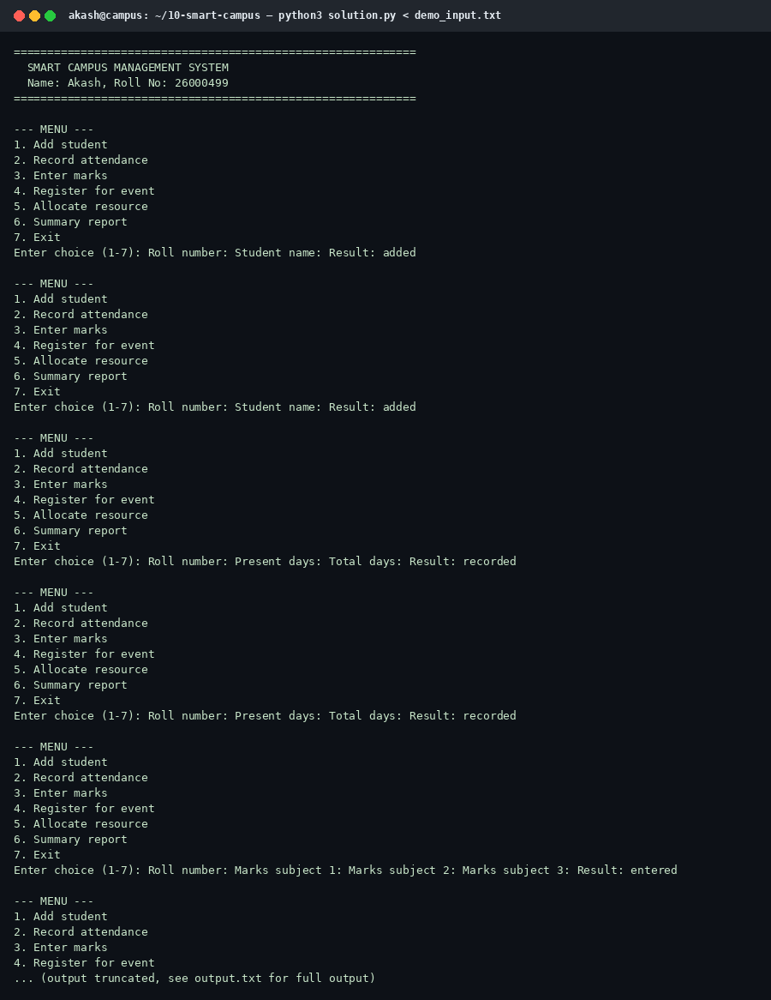

# Case Study 10 — Comprehensive Smart Campus Management Simulation

**Name:** Akash  
**Roll No:** 26000499  
**Subject:** Python Programming — Activity-Based Learning

## 1. Problem Statement

Develop a menu-driven program that integrates student records, attendance, marks, event registration, resource allocation, and summary reporting using conditional statements, loops, strings, lists, nested lists, tuples, and tuple unpacking.

Menu options:
1. Add student (roll, name)
2. Record attendance (roll, present days, total days)
3. Enter marks (roll, 3 subject marks)
4. Register for event (roll, event name, fee Rs 200)
5. Allocate resource (Projector/Laptop/Camera, quantity)
6. Summary report
7. Exit

## 2. Objectives

- Use a while loop with if-elif for menu handling.
- Store students as list of tuples, attendance/marks as nested lists, registrations as list of tuples.
- Validate every input (duplicate roll, unknown student, invalid marks, over-allocation).
- Use tuple unpacking when reading records.
- Generate a combined summary report.

## 3. Assumptions

- Roll numbers are unique strings like "S101".
- Attendance total days must be > 0 and present days between 0 and total.
- Marks are between 0 and 100.
- Event fee is Rs 200 per registration.
- Resources: Projector (5), Laptop (10), Camera (3) available.
- Demo input file is used for automated run; program also works interactively.

## 4. Algorithm

```
1. START
2. Initialize students=[], attendance=[], marks=[], registrations=[]
   resources = [["Projector",5,0],["Laptop",10,0],["Camera",3,0]]
3. WHILE True:
   3.1 Print menu, read choice
   3.2 IF choice = "1": read roll, name; IF roll exists THEN error ELSE append (roll,name)
   3.3 ELSE IF choice = "2": read roll, present, total; validate student exists and values; update or append [roll,present,total]
   3.4 ELSE IF choice = "3": read roll, m1,m2,m3; validate student and 0<=marks<=100; update or append [roll,[m1,m2,m3]]
   3.5 ELSE IF choice = "4": read roll, event; validate student and not already registered; append (roll,event)
   3.6 ELSE IF choice = "5": read resource name, qty; validate qty>0, resource exists, allocated+qty <= available; update allocated
   3.7 ELSE IF choice = "6": print summary (students, attendance %, marks avg, registrations + fee, resources)
   3.8 ELSE IF choice = "7": print exit message and BREAK
   3.9 ELSE print "Invalid choice"
4. END
```

## 5. Flowchart

```
                    +---------+
                    |  START  |
                    +----┬----+
                         v
              +----------------------+
              | show menu, read      |
              | choice               |
              +----------+-----------+
                         v
              +----------------------+
              | choice = 1..7 ?      |
              +----+---+---+---+---+---+
                   |   |   |   |   |
                   v   v   v   v   v
              +---+ +---+ +---+ +---+ +---+
              |add| |att| |mrk| |evt| |res|
              +---+ +---+ +---+ +---+ +---+
                   |   |   |   |   |
                   +---+---+---+---+---+
                           |
              +------------+------------+
              | choice = 6 ? summary   |
              | choice = 7 ? exit      |
              +------------+------------+
                           |
                           +---- back to menu
```

## 6. Pseudocode

```
BEGIN SMART_CAMPUS
    students <- []          // list of (roll, name) tuples
    attendance <- []        // list of [roll, present, total]
    marks <- []             // list of [roll, [m1,m2,m3]]
    registrations <- []     // list of (roll, event) tuples
    resources <- [["Projector",5,0],["Laptop",10,0],["Camera",3,0]]

    WHILE True DO
        PRINT menu
        choice <- INPUT()
        IF choice = "1" THEN
            roll <- INPUT(), name <- INPUT()
            IF roll IN students THEN PRINT "already exists"
            ELSE APPEND (roll, name) TO students
        ELSE IF choice = "2" THEN
            roll, present, total <- INPUT()
            IF roll NOT IN students THEN PRINT "not found"
            ELSE IF invalid THEN PRINT "invalid values"
            ELSE UPDATE attendance
        ELSE IF choice = "3" THEN
            // similar validation for marks
        ELSE IF choice = "4" THEN
            // check duplicate registration
        ELSE IF choice = "5" THEN
            // check resource availability
        ELSE IF choice = "6" THEN
            PRINT summary report
        ELSE IF choice = "7" THEN
            PRINT "Exiting"
            EXIT LOOP
        ELSE
            PRINT "Invalid choice"
        END IF
    END WHILE
END
```

## 7. Python Source Code

Full program: [`solution.py`](./solution.py)

Sample functions:

```python
def add_student(roll, name):
    if find_student(roll):
        return False, "roll already exists"
    students.append((roll, name))
    return True, "added"

def record_attendance(roll, present, total):
    if not find_student(roll):
        return False, "student not found"
    if total <= 0 or present < 0 or present > total:
        return False, "invalid attendance values"
    for entry in attendance:
        if entry[0] == roll:
            entry[1] = present
            entry[2] = total
            return True, "updated"
    attendance.append([roll, present, total])
    return True, "recorded"

def allocate_resource(name, qty):
    if qty <= 0:
        return False, "quantity must be positive"
    for res in resources:
        if res[0] == name:
            if res[2] + qty > res[1]:
                return False, "not enough available"
            res[2] = res[2] + qty
            return True, "allocated"
    return False, "resource not found"
```

Run interactively: `python3 solution.py`  
Run with demo input: `python3 solution.py < demo_input.txt`

## 8. Test Cases

Test file: [`test_cases.py`](./test_cases.py) — 12 tests, all passing.

| ID | Input | Expected | Result |
|----|-------|----------|--------|
| TC-01 | add_student S101 Ananya | added | True — PASS |
| TC-02 | add_student S101 again | duplicate rejected | False — PASS |
| TC-03 | record_attendance S101 40/50 | recorded | True — PASS |
| TC-04 | record_attendance S999 | unknown student | False — PASS |
| TC-05 | record_attendance 60/50 | invalid values | False — PASS |
| TC-06 | enter_marks S101 80,75,90 | entered | True — PASS |
| TC-07 | enter_marks 110 | invalid marks | False — PASS |
| TC-08 | register_event S101 Hackathon | registered | True — PASS |
| TC-09 | register_event again | duplicate rejected | False — PASS |
| TC-10 | allocate Projector 2 | allocated | True — PASS |
| TC-11 | allocate Projector 10 | over-allocation | False — PASS |
| TC-12 | allocate Unknown | resource not found | False — PASS |

## 9. Output



Full output: [`output.txt`](./output.txt) (generated from `demo_input.txt`)

Demo input adds 2 students, records attendance, enters marks, registers both for Hackathon, allocates Projector 2 and Laptop 3, then shows summary:

```
===== SUMMARY REPORT =====
Total students: 2

Students:
  S101 - Ananya
  S102 - Bharat

Attendance:
  S101 : 40/50 = 80.0%
  S102 : 35/50 = 70.0%

Marks (average):
  S101 : [80, 75, 90] avg 81.67
  S102 : [60, 55, 70] avg 61.67

Event registrations (fee Rs 200 each):
  S101 -> Hackathon
  S102 -> Hackathon
  Total fee collected: Rs 400

Resources:
  Projector : allocated 2 of 5
  Laptop : allocated 3 of 10
  Camera : allocated 0 of 3
```

## 10. Conclusion

This final case study combines everything from the syllabus — loops, conditionals, strings, lists, nested lists, tuples and unpacking — into one menu-driven system. All validations (duplicate roll, unknown student, invalid marks, over-allocation) worked correctly. The summary report shows attendance percentages, mark averages, fee collection and resource usage in one place. All 12 test cases passed.
