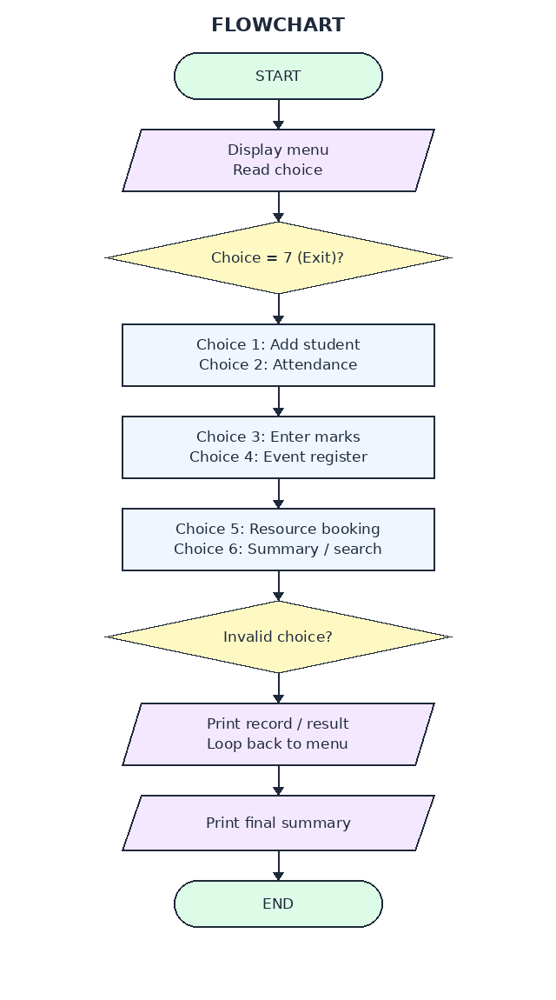

# Comprehensive Smart Campus Management Simulation

Name: Akash  
Roll No: 26000499

## Problem statement

Develop a menu-driven program that integrates student records, attendance, marks, event registration, resource allocation, and summary reporting using conditional statements, loops, strings, lists, nested lists, tuples, and tuple unpacking.

Menu options:
1. Add student (roll, name)
2. Record attendance (roll, present days, total days)
3. Enter marks (roll, 3 subject marks)
4. Register for event (roll, event name, fee Rs 200)
5. Allocate resource (Projector/Laptop/Camera, quantity)
6. Summary report
7. Exit

## Objectives

- Use a while loop with if-elif for menu handling.
- Store students as list of tuples, attendance/marks as nested lists, registrations as list of tuples.
- Validate every input (duplicate roll, unknown student, invalid marks, over-allocation).
- Use tuple unpacking when reading records.
- Generate a combined summary report.

## Assumptions

- Roll numbers are unique strings like "S101".
- Attendance total days must be > 0 and present days between 0 and total.
- Marks are between 0 and 100.
- Event fee is Rs 200 per registration.
- Resources: Projector (5), Laptop (10), Camera (3) available.
- Demo input file is used for automated run; program also works interactively.

## Algorithm

```
1. START
2. Initialize students=[], attendance=[], marks=[], registrations=[]
   resources = [["Projector",5,0],["Laptop",10,0],["Camera",3,0]]
3. WHILE True:
   3.1 Print menu, read choice
   3.2 IF choice = "1": read roll, name; IF roll exists THEN error ELSE append (roll,name)
   3.3 ELSE IF choice = "2": read roll, present, total; validate student exists and values; update or append [roll,present,total]
   3.4 ELSE IF choice = "3": read roll, m1,m2,m3; validate student and 0<=marks<=100; update or append [roll,[m1,m2,m3]]
   3.5 ELSE IF choice = "4": read roll, event; validate student and not already registered; append (roll,event)
   3.6 ELSE IF choice = "5": read resource name, qty; validate qty>0, resource exists, allocated+qty <= available; update allocated
   3.7 ELSE IF choice = "6": print summary (students, attendance %, marks avg, registrations + fee, resources)
   3.8 ELSE IF choice = "7": print exit message and BREAK
   3.9 ELSE print "Invalid choice"
4. END
```

## Flowchart



## Pseudocode

```
BEGIN SMART_CAMPUS
    students <- []          // list of (roll, name) tuples
    attendance <- []        // list of [roll, present, total]
    marks <- []             // list of [roll, [m1,m2,m3]]
    registrations <- []     // list of (roll, event) tuples
    resources <- [["Projector",5,0],["Laptop",10,0],["Camera",3,0]]

    WHILE True DO
        PRINT menu
        choice <- INPUT()
        IF choice = "1" THEN
            roll <- INPUT(), name <- INPUT()
            IF roll IN students THEN PRINT "already exists"
            ELSE APPEND (roll, name) TO students
        ELSE IF choice = "2" THEN
            roll, present, total <- INPUT()
            IF roll NOT IN students THEN PRINT "not found"
            ELSE IF invalid THEN PRINT "invalid values"
            ELSE UPDATE attendance
        ELSE IF choice = "3" THEN
            // similar validation for marks
        ELSE IF choice = "4" THEN
            // check duplicate registration
        ELSE IF choice = "5" THEN
            // check resource availability
        ELSE IF choice = "6" THEN
            PRINT summary report
        ELSE IF choice = "7" THEN
            PRINT "Exiting"
            EXIT LOOP
        ELSE
            PRINT "Invalid choice"
        END IF
    END WHILE
END
```

## Python source code

```python
"""
Case Study 10: Comprehensive Smart Campus Management Simulation
Name: Akash, Roll No: 26000499
Syllabus used: menu loops, conditionals, strings, lists, nested lists,
tuples, tuple unpacking, operators
"""

# student record as tuple: (roll, name)
students = []
# attendance: list of [roll, present_days, total_days] -> nested list
attendance = []
# marks: list of [roll, [m1, m2, m3]]
marks = []
# event registrations: list of (roll, event_name)
registrations = []
# resources: list of [resource_name, available, allocated]
resources = [
    ["Projector", 5, 0],
    ["Laptop", 10, 0],
    ["Camera", 3, 0],
]
EVENT_FEE = 200


def find_student(roll):
    for r, n in students:
        if r == roll:
            return True
    return False


def add_student(roll, name):
    if find_student(roll):
        return False, "roll already exists"
    students.append((roll, name))
    return True, "added"


def record_attendance(roll, present, total):
    if not find_student(roll):
        return False, "student not found"
    if total <= 0 or present < 0 or present > total:
        return False, "invalid attendance values"
    for entry in attendance:
        if entry[0] == roll:
            entry[1] = present
            entry[2] = total
            return True, "updated"
    attendance.append([roll, present, total])
    return True, "recorded"


def enter_marks(roll, m1, m2, m3):
    if not find_student(roll):
        return False, "student not found"
    for m in [m1, m2, m3]:
        if m < 0 or m > 100:
            return False, "marks must be between 0 and 100"
    for entry in marks:
        if entry[0] == roll:
            entry[1] = [m1, m2, m3]
            return True, "updated"
    marks.append([roll, [m1, m2, m3]])
    return True, "entered"


def register_event(roll, event):
    if not find_student(roll):
        return False, "student not found"
    for r, e in registrations:
        if r == roll and e == event:
            return False, "already registered"
    registrations.append((roll, event))
    return True, "registered"


def allocate_resource(name, qty):
    if qty <= 0:
        return False, "quantity must be positive"
    for res in resources:
        if res[0] == name:
            if res[2] + qty > res[1]:
                return False, "not enough available"
            res[2] = res[2] + qty
            return True, "allocated"
    return False, "resource not found"


def summary():
    print("\n===== SUMMARY REPORT =====")
    print("Total students: %d" % len(students))
    print("\nStudents:")
    for roll, name in students:
        print("  %s - %s" % (roll, name))
    print("\nAttendance:")
    for roll, present, total in attendance:
        pct = (present / total) * 100
        print("  %s : %d/%d = %.1f%%" % (roll, present, total, pct))
    print("\nMarks (average):")
    for roll, mlist in marks:
        total = mlist[0] + mlist[1] + mlist[2]
        avg = total / 3
        print("  %s : %s avg %.2f" % (roll, mlist, avg))
    print("\nEvent registrations (fee Rs %d each):" % EVENT_FEE)
    for roll, event in registrations:
        print("  %s -> %s" % (roll, event))
    print("  Total fee collected: Rs %d" % (len(registrations) * EVENT_FEE))
    print("\nResources:")
    for name, avail, alloc in resources:
        print("  %s : allocated %d of %d" % (name, alloc, avail))


def main():
    print("=" * 60)
    print("  SMART CAMPUS MANAGEMENT SYSTEM")
    print("  Name: Akash, Roll No: 26000499")
    print("=" * 60)
    while True:
        print("\n--- MENU ---")
        print("1. Add student")
        print("2. Record attendance")
        print("3. Enter marks")
        print("4. Register for event")
        print("5. Allocate resource")
        print("6. Summary report")
        print("7. Exit")
        choice = input("Enter choice (1-7): ").strip()

        if choice == "1":
            roll = input("Roll number: ").strip()
            name = input("Student name: ").strip()
            ok, msg = add_student(roll, name)
            print("Result:", msg)
        elif choice == "2":
            roll = input("Roll number: ").strip()
            present_text = input("Present days: ").strip()
            total_text = input("Total days: ").strip()
            if not present_text.isdigit() or not total_text.isdigit():
                print("Result: attendance values must be whole numbers")
            else:
                ok, msg = record_attendance(roll, int(present_text), int(total_text))
                print("Result:", msg)
        elif choice == "3":
            roll = input("Roll number: ").strip()
            m1_text = input("Marks subject 1: ").strip()
            m2_text = input("Marks subject 2: ").strip()
            m3_text = input("Marks subject 3: ").strip()
            if not m1_text.isdigit() or not m2_text.isdigit() or not m3_text.isdigit():
                print("Result: marks must be whole numbers")
            else:
                ok, msg = enter_marks(roll, int(m1_text), int(m2_text), int(m3_text))
                print("Result:", msg)
        elif choice == "4":
            roll = input("Roll number: ").strip()
            event = input("Event name: ").strip()
            ok, msg = register_event(roll, event)
            print("Result:", msg)
        elif choice == "5":
            name = input("Resource name (Projector/Laptop/Camera): ").strip()
            qty_text = input("Quantity: ").strip()
            if not qty_text.isdigit():
                print("Result: quantity must be a whole number")
            else:
                ok, msg = allocate_resource(name, int(qty_text))
                print("Result:", msg)
        elif choice == "6":
            summary()
        elif choice == "7":
            print("Exiting. Thank you!")
            break
        else:
            print("Invalid choice. Please enter 1 to 7.")


if __name__ == "__main__":
    main()
```

## Test cases

```python
"""Test cases for Case Study 10 - Smart Campus Management Simulation."""
import importlib.util
import os

spec = importlib.util.spec_from_file_location("sol", os.path.join(os.path.dirname(__file__), "solution.py"))
sol = importlib.util.module_from_spec(spec)
spec.loader.exec_module(sol)

passed = 0

def check(label, condition):
    global passed
    assert condition, "FAILED: " + label
    passed += 1
    print("  PASS:", label)

# reset state
sol.students.clear()
sol.attendance.clear()
sol.marks.clear()
sol.registrations.clear()
for res in sol.resources:
    res[2] = 0

ok, msg = sol.add_student("S101", "Ananya")
check("add student works", ok == True)
ok, msg = sol.add_student("S101", "Duplicate")
check("duplicate roll rejected", ok == False)

ok, msg = sol.record_attendance("S101", 40, 50)
check("attendance recorded", ok == True)
ok, msg = sol.record_attendance("S999", 10, 20)
check("unknown student attendance rejected", ok == False)
ok, msg = sol.record_attendance("S101", 60, 50)
check("present > total rejected", ok == False)

ok, msg = sol.enter_marks("S101", 80, 75, 90)
check("marks entered", ok == True)
ok, msg = sol.enter_marks("S101", 110, 75, 90)
check("marks > 100 rejected", ok == False)

ok, msg = sol.register_event("S101", "Hackathon")
check("event registration works", ok == True)
ok, msg = sol.register_event("S101", "Hackathon")
check("duplicate registration rejected", ok == False)

ok, msg = sol.allocate_resource("Projector", 2)
check("resource allocation works", ok == True)
ok, msg = sol.allocate_resource("Projector", 10)
check("over-allocation rejected", ok == False)
ok, msg = sol.allocate_resource("Unknown", 1)
check("unknown resource rejected", ok == False)

print("\nALL %d TESTS PASSED (Case Study 10)" % passed)
```

## Output screenshot

```
============================================================
  SMART CAMPUS MANAGEMENT SYSTEM
  Name: Akash, Roll No: 26000499
============================================================

--- MENU ---
1. Add student
2. Record attendance
3. Enter marks
4. Register for event
5. Allocate resource
6. Summary report
7. Exit
Enter choice (1-7): Roll number: Student name: Result: added

--- MENU ---
1. Add student
2. Record attendance
3. Enter marks
4. Register for event
5. Allocate resource
6. Summary report
7. Exit
Enter choice (1-7): Roll number: Student name: Result: added

--- MENU ---
1. Add student
2. Record attendance
3. Enter marks
4. Register for event
5. Allocate resource
6. Summary report
7. Exit
Enter choice (1-7): Roll number: Present days: Total days: Result: recorded

--- MENU ---
1. Add student
2. Record attendance
3. Enter marks
4. Register for event
5. Allocate resource
6. Summary report
7. Exit
Enter choice (1-7): Roll number: Present days: Total days: Result: recorded

--- MENU ---
1. Add student
2. Record attendance
3. Enter marks
4. Register for event
5. Allocate resource
6. Summary report
7. Exit
Enter choice (1-7): Roll number: Marks subject 1: Marks subject 2: Marks subject 3: Result: entered

--- MENU ---
1. Add student
2. Record attendance
3. Enter marks
4. Register for event
5. Allocate resource
6. Summary report
7. Exit
Enter choice (1-7): Roll number: Marks subject 1: Marks subject 2: Marks subject 3: Result: entered

--- MENU ---
1. Add student
2. Record attendance
3. Enter marks
4. Register for event
5. Allocate resource
6. Summary report
7. Exit
Enter choice (1-7): Roll number: Event name: Result: registered

--- MENU ---
1. Add student
2. Record attendance
3. Enter marks
4. Register for event
5. Allocate resource
6. Summary report
7. Exit
Enter choice (1-7): Roll number: Event name: Result: registered

--- MENU ---
1. Add student
2. Record attendance
3. Enter marks
4. Register for event
5. Allocate resource
6. Summary report
7. Exit
Enter choice (1-7): Resource name (Projector/Laptop/Camera): Quantity: Result: allocated

--- MENU ---
1. Add student
2. Record attendance
3. Enter marks
4. Register for event
5. Allocate resource
6. Summary report
7. Exit
Enter choice (1-7): Resource name (Projector/Laptop/Camera): Quantity: Result: allocated

--- MENU ---
1. Add student
2. Record attendance
3. Enter marks
4. Register for event
5. Allocate resource
6. Summary report
7. Exit
Enter choice (1-7): 
===== SUMMARY REPORT =====
Total students: 2

Students:
  S101 - Ananya
  S102 - Bharat

Attendance:
  S101 : 40/50 = 80.0%
  S102 : 35/50 = 70.0%

Marks (average):
  S101 : [80, 75, 90] avg 81.67
  S102 : [60, 55, 70] avg 61.67

Event registrations (fee Rs 200 each):
  S101 -> Hackathon
  S102 -> Hackathon
  Total fee collected: Rs 400

Resources:
  Projector : allocated 2 of 5
  Laptop : allocated 3 of 10
  Camera : allocated 0 of 3

--- MENU ---
1. Add student
2. Record attendance
3. Enter marks
4. Register for event
5. Allocate resource
6. Summary report
7. Exit
Enter choice (1-7): Exiting. Thank you!
```


## Conclusion

This final case study combines everything from the syllabus — loops, conditionals, strings, lists, nested lists, tuples and unpacking — into one menu-driven system. All validations (duplicate roll, unknown student, invalid marks, over-allocation) worked correctly. The summary report shows attendance percentages, mark averages, fee collection and resource usage in one place. All 12 test cases passed.
